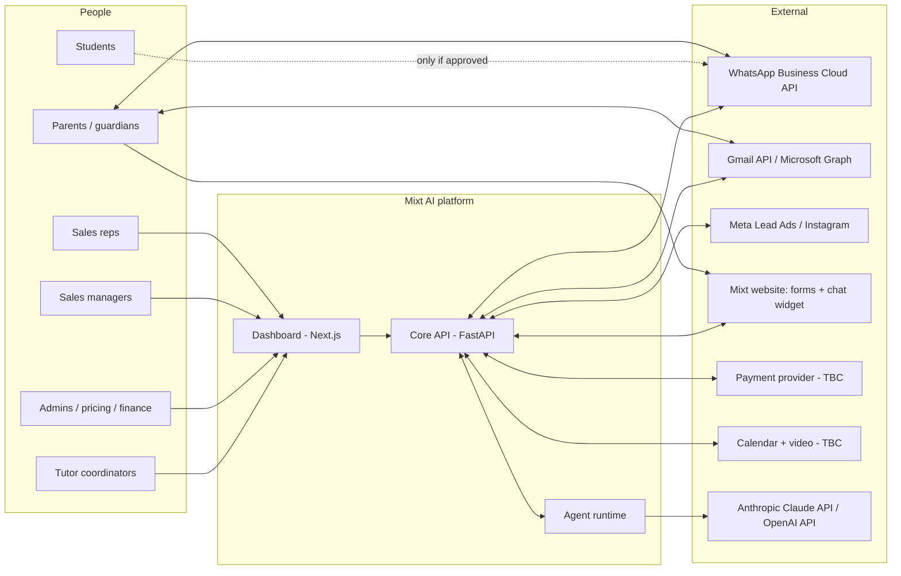
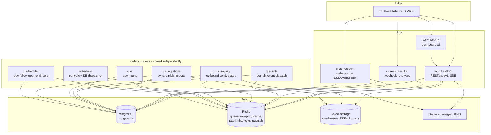
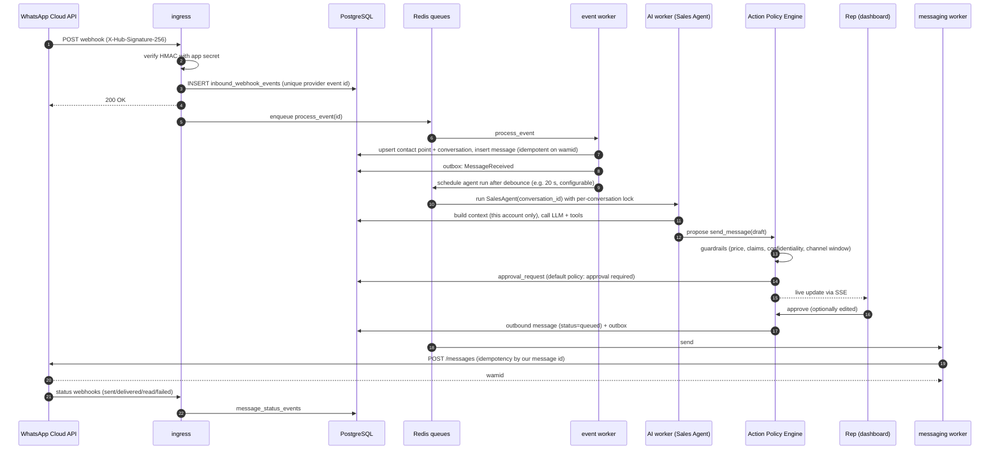

# 01: System Architecture

Status: **APPROVED 2026-11-10** (BD-032) · Implementation in progress: see the [roadmap](10-roadmap.md) for what exists.

## 1. Architectural principles

1. **One source of truth.** A single PostgreSQL database holds the CRM. Every module and every agent reads and writes through the same domain services. No agent has its own customer store.
2. **Deterministic core, AI at the edges.** Prices, permissions, eligibility, state changes, ledgers and approvals are **ordinary tested code**. LLMs understand language, draft text, extract facts and *propose* actions. They never decide prices or bypass policy.
3. **People in control by default.** Every side effect an agent proposes goes through an **Action Policy Engine** that decides: run automatically, queue for approval, or refuse. Default: important actions need approval.
4. **Durable, idempotent side effects.** Inbound webhooks are stored before processing; outbound messages go through a transactional outbox; jobs can be retried without duplicates.
5. **Least privilege everywhere.** Staff, services and agents get only the permissions they need. Agents act as non-human principals with their own scopes.
6. **Configuration as data.** Pricing, pipelines, approval rules, templates, knowledge and prompts live in the database with versioning, so business changes need no code changes.
7. **Auditability.** Every customer-facing AI output is traceable to the agent version, prompt version, model, context, tools and approver.
8. **Modular monolith first.** One deployable backend with strict internal module boundaries. Modules can be split out later if load or team size requires it.
9. **Privacy and security by design.** Data minimisation (especially for minors), encryption, consent tracking and regional compliance from the start.
10. **Nothing counts as done without tests.**

## 2. System context



## 3. Containers (runtime components)



| Component | Responsibility | Scaling |
|-----------|---------------|---------|
| **web** | Dashboard. Server-rendered shell, client data via the typed API client. No business logic. | Horizontal, stateless |
| **api** | All business operations through domain services; authentication; authorisation; validation; SSE for live inbox updates. | Horizontal, stateless |
| **ingress** | Webhook endpoints only: verify signature → store raw event → enqueue → return `200` fast. Deployed separately so a busy dashboard cannot slow message intake. | Horizontal |
| **chat** | Website chat sessions (streaming). Separate so long-lived connections don't tie up the API. | Horizontal |
| **workers** | All slow or external work: agent runs, sending, syncs, imports, scheduled actions. Separate queues so one slow area (e.g. LLM latency) cannot starve another (e.g. sending). | Per queue |
| **scheduler** | Periodic jobs (e.g. renew Gmail/Graph subscriptions, expire promotions) and a **database dispatcher** that turns due rows in `scheduled_actions` into jobs. | Single active instance (leader lock) |
| **PostgreSQL** | System of record, including durable job intent (outbox, scheduled actions). pgvector for knowledge-base retrieval. | Vertical + read replica for reports |
| **Redis** | Queue transport, rate limiting, distributed locks, short-lived cache, pub/sub for live UI. **Not** a system of record: losing Redis loses no business data. | Managed, replicated |
| **Object storage** | Message media, quotation PDFs, pricing import files, exports. Private, encrypted, accessed through signed URLs. | Managed |

## 4. Backend module structure (bounded contexts)

| Module | Owns | Main consumers |
|--------|------|----------------|
| `identity` | Users, roles, permissions, teams, sessions, MFA, agent principals | Everything |
| `reference` | Countries, markets, currencies, curricula, exam boards, qualifications, grade levels, subjects, languages | Everything |
| `crm` | Accounts, contacts, contact points, consents, students, academic profiles, tags, notes, merges | All agents |
| `leads` | Lead intake, sources, campaigns, attribution, dedupe, routing | Lead agents |
| `pipeline` | Opportunities, stages, stage history, lost reasons, assignment | Sales, Manager |
| `conversations` | Conversations, messages, attachments, statuses, human takeover | Sales, channel agents |
| `messaging` | Channel adapters, templates, outbox, suppression, quiet hours, frequency caps | WhatsApp/Email agents |
| `pricing` | Price books, versions, entries, benefits, policies, promotions, customer pricing, rules, imports | Pricing, Negotiation, Sales |
| `quotations` | Quotations, lines, snapshots, documents, revisions | Sales, Negotiation, Payments |
| `approvals` | Approval policies, requests, decisions | Everything with side effects |
| `tutors` | Tutor profiles, qualifications, availability, compliance checks, assignments | Matching, Scheduling |
| `scheduling` | Trials, lessons, calendar events, reminders | Scheduling, Retention |
| `enrolment` | Package purchases, hours ledger, pauses, family allocation | Payments, Retention |
| `payments` | Invoices, payments, allocations, refunds, provider events | Payment Tracking |
| `engagement` | Tasks, follow-up sequences, retention signals, health scores, referrals, feedback | Follow-up, Retention |
| `ai` | Agent definitions, runs, steps, LLM calls, proposed actions, escalations, memory, guardrails, evals | Agent runtime |
| `knowledge` | Knowledge documents, chunks, embeddings, approval | AI agents |
| `integrations` | Connections, encrypted credentials, webhook events, sync cursors | Channel modules |
| `audit` | Audit log, data-subject requests, retention jobs | Admin, compliance |
| `settings` | Setting definitions, scoped values with `safe_default`/`confirmed` status and decision references ([13](13-configurable-settings.md)) | Everything that depends on an outstanding business decision |
| `analytics` | Read models, metric definitions, report queries | Reports, Manager agent |

**Module rules (enforced with import-linting in CI):**
- A module exposes a public `service` interface and Pydantic schemas. Other modules never import its ORM models or repositories directly.
- Writes that cross modules go through the owning module's service, or through domain events.
- The `ai` module has **no direct database write access** to other modules. It calls the same services as people do, through the tool layer and the Action Policy Engine.

**Inside each module:**
```
<module>/
  models.py       # SQLAlchemy ORM tables (private to module)
  schemas.py      # Pydantic v2 input/output contracts (public)
  service.py      # use cases; transactions; emits domain events (public)
  repository.py   # queries (private)
  policies.py     # authorisation + business rules (pure functions, unit-tested)
  events.py       # domain event definitions
  router.py       # FastAPI routes (thin)
  tasks.py        # Celery tasks (thin wrappers around service calls)
```

## 5. Main flows

### 5.1 Inbound WhatsApp message → AI draft → approval → send



### 5.2 Lead from Meta Lead Ads → qualified, assigned lead

1. Meta sends a `leadgen` webhook to `ingress` → signature verified → raw event stored.
2. Worker fetches the full lead from the Graph API using the stored Page token (official API only).
3. `leads.intake()` normalises data (E.164 phone, email, country), records source/campaign/ad attribution and consent text shown on the form.
4. Duplicate detection against contact points → link to an existing account or create a new lead.
5. Country check: country in the 13 markets → continue; **US or other non-target → flagged `out_of_market` for a person to review** (no automated outreach).
6. `LeadCreated` event → Lead Qualification Agent extracts and scores → proposes stage and owner.
7. Routing rules (market, language, workload) assign a rep; an SLA timer starts.
8. Follow-up Agent drafts the first contact (WhatsApp template if the person opted in on the form) → approval → send.

### 5.3 Quotation

1. Rep or AI Sales Agent asks the **Pricing tool** for eligible options for `(account, student(s), market, plan, hours)`.
2. The pricing engine resolves options **deterministically** (see [04](04-pricing-engine.md)). If there is no approved pricing it refuses with a reason code, and the agent escalates.
3. Draft quotation created with an **immutable snapshot** (price book version, entry, tier, currency, amounts, benefits, policies).
4. Approval policy checks: list price → approval per default policy; any discount or custom price → approval by someone with enough discount authority.
5. Issued: PDF stored; sent through the customer's channel; `QuotationIssued` event → Follow-up Agent schedules a check-in.
6. Accepted → invoice/payment link → `PaymentConfirmed` → enrolment and hours credited.

## 6. Domain events and background processing

- **Transactional outbox:** a service writes its state change and an `outbox_events` row **in the same transaction**. A dispatcher publishes outbox rows to Redis queues and marks them dispatched. Consumers are idempotent (they record processed event IDs per consumer).
- **Example events:** `LeadCreated`, `LeadQualified`, `MessageReceived`, `MessageStatusChanged`, `ConversationEscalated`, `QuotationIssued`, `QuotationAccepted`, `TrialScheduled`, `TrialCompleted`, `PaymentConfirmed`, `PackageActivated`, `HoursBalanceLow`, `PackageExpiring`, `ConsentChanged`, `PriceBookVersionActivated`.
- **Scheduled actions:** business-timed work (follow-up in 2 days, reminder 24 h before a trial) is stored in `scheduled_actions` in PostgreSQL. The dispatcher claims due rows with `SELECT … FOR UPDATE SKIP LOCKED`. Redis only carries the work.
- **Retries:** exponential backoff with jitter; per-task maximum attempts; non-retryable errors (validation, 4xx policy errors) fail immediately; exhausted jobs go to a **dead-letter table** shown in the Integrations dashboard with a replay button.
- **Idempotency:** unique constraints on provider IDs (e.g. WhatsApp `wamid`, Gmail message id, Meta `leadgen_id`), an `Idempotency-Key` header on mutating API calls, and deterministic job keys.
- **Concurrency:** a per-conversation advisory lock means only one agent run replies to a conversation at a time; customer message bursts are **debounced** before the AI runs.

## 7. Technology stack (PROPOSAL)

| Layer | Choice | Reason |
|-------|--------|--------|
| Frontend | **Next.js** (App Router) · **React** · **TypeScript** (strict) · **Tailwind CSS** | As requested; mature; server rendering for a fast dashboard shell |
| UI components | shadcn/ui (Radix primitives) · TanStack Table · TanStack Query · React Hook Form + Zod · Recharts | Accessible primitives; serious data tables; typed forms |
| API client | Generated from FastAPI's OpenAPI schema (`openapi-typescript`) | Frontend and backend types stay in sync |
| Backend | **Python 3.12+** · **FastAPI** · Pydantic v2 · SQLAlchemy 2.0 · Alembic | As requested; typed; strong validation |
| Data access style | **Synchronous SQLAlchemy sessions** shared by API and workers; async only at the network edges (chat streaming, LLM/HTTP calls) | One code path for domain services in API and workers; simpler and less error-prone at this scale |
| Background jobs | **Celery** with **Redis** broker; PostgreSQL outbox + `scheduled_actions` for durability | Mature retries, routing, rate limits, monitoring; durability doesn't depend on Redis |
| Database | **PostgreSQL 17+** (managed) · `pgvector` · `pgcrypto` · `btree_gist` | One system of record; vector search without another database; exclusion constraints for pricing date ranges |
| AI | Anthropic SDK and OpenAI SDK behind a `ModelGateway` interface | Interchangeable providers; per-task model profiles; fallback |
| HTTP | `httpx` with timeouts, retries, circuit breakers | External APIs |
| Observability | `structlog` JSON logs · OpenTelemetry traces · Sentry · Prometheus metrics | Linked logs/traces; error alerting |
| Testing | pytest · testcontainers (real PostgreSQL/Redis) · Hypothesis (property tests) · Playwright (E2E) · AI evaluation harness | Real infrastructure in tests; pricing properties; AI regression gates |
| Infrastructure | Docker · docker compose (local) · Terraform (cloud) · GitHub Actions CI/CD | Reproducible environments |
| Hosting | Managed containers + managed PostgreSQL + managed Redis in **one region chosen for data protection** (Q-CMP-02) | AWS has regions in or near most target markets (e.g. London, Ireland, UAE, Bahrain, Singapore); final choice depends on legal advice |

## 8. API design

- REST, JSON, versioned at `/api/v1`; OpenAPI 3.1 generated from code.
- Errors follow **RFC 9457** (`application/problem+json`) with stable machine-readable `code` values (e.g. `PRICING_NOT_AVAILABLE_FOR_MARKET`).
- Cursor pagination; explicit filter parameters; no unbounded queries.
- `Idempotency-Key` required on POSTs that cause external side effects (send message, issue quotation, create payment link).
- Optimistic concurrency with `version` columns on editable records (`If-Match`), so two reps cannot silently overwrite each other's edits.
- Server-Sent Events for live updates (inbox, approvals, agent runs), backed by Redis pub/sub.

## 9. Frontend architecture

- Route groups per dashboard module (`/overview`, `/leads`, `/customers/[id]`, `/conversations`, `/pricing/...`).
- Authentication through an httpOnly, Secure, SameSite cookie issued by the API; CSRF token on mutating requests.
- Navigation and actions are **permission-aware**, but the API always enforces permissions; the UI only hides what a user can't do.
- Design tokens (colour, type, spacing) in one Tailwind theme (see [09](09-dashboard-ux.md)).
- Shared components: data table (sort, filter, saved views, column visibility, CSV export with permission check), entity timeline, approval card, AI draft review panel, money display (always with an explicit currency code).

## 10. Observability and operations

- Every request, job and agent run has a correlation ID passed through logs and traces.
- PII is redacted from logs by default (phone, email and message bodies are masked; message bodies are kept only in the database).
- Dashboards: webhook intake lag, queue depth per queue, dead-letter count, send failure rate by channel, LLM latency/error/cost by profile, guardrail block rate, approval backlog and age.
- Alerts: webhook verification failures spike, outbox lag > 2 min, dead letters > 0 for messaging, provider token expiry within 7 days, Gmail/Graph subscription renewal failure, LLM error rate, guardrail violations.

## 11. Environments and deployment

| Environment | Purpose | Data |
|-------------|---------|------|
| local | Development via docker compose | Synthetic seed data only |
| staging | Integration with **test** WhatsApp numbers, sandbox payment provider, test mailboxes | Synthetic or anonymised only, **never real customer data** |
| production | Live | Real data; access restricted and audited |

- CI on every PR: lint, type-check (mypy/pyright, tsc), unit and integration tests, migration up/down check, import-boundary check, dependency vulnerability scan, secret scan, AI eval suite (for prompt/agent changes).
- Deployment: build immutable images → migrate (backward-compatible "expand → migrate → contract" pattern) → rolling deploy → smoke tests.
- Feature flags for staged rollout of agents and channels.

## 12. Scalability

Expected volumes are unknown (Q-TECH-02). The design comfortably handles hundreds of thousands of contacts and tens of millions of messages on a single well-indexed PostgreSQL primary. Growth paths that don't require redesign: read replica for analytics; time-based partitioning of `messages`, `audit_log`, `llm_calls` and `inbound_webhook_events`; more workers per queue; splitting `ingress` or `ai` into separate services.

## 13. Key architecture decisions (summary)

| # | Decision | Alternatives considered | Why |
|---|----------|------------------------|-----|
| ADR-01 | Modular monolith + separate worker processes | Microservices | Small team, strong consistency needs (pricing ↔ quotation ↔ ledger), lower running cost; clean boundaries keep later extraction possible |
| ADR-02 | PostgreSQL as single system of record, incl. job intent | Separate stores per agent; Redis as source of truth | Required by the brief; durability; transactional consistency |
| ADR-03 | Deterministic pricing engine; LLM may only call it | LLM reasoning over price tables in the prompt | Removes the risk of made-up prices; testable |
| ADR-04 | Action Policy Engine between agents and side effects | Agents call APIs directly | Human control, configurable autonomy, a single audit point |
| ADR-05 | Agents talk to each other only through the CRM, events and typed tools | Free-form agent-to-agent chat | Traceable, testable, no hidden state |
| ADR-06 | Celery + Redis transport; PostgreSQL outbox/scheduled actions | Pure Redis queues; Kafka | Mature tooling; no business data lost if Redis fails; Kafka is unnecessary at this scale |
| ADR-07 | Synchronous ORM sessions in domain services | Fully async stack | One code path shared by API and workers; async only where it pays (streaming, outbound HTTP) |
| ADR-08 | pgvector inside PostgreSQL for knowledge retrieval | Separate vector database | Fewer moving parts; the knowledge base is small and admin-curated |
| ADR-09 | Money as integer minor units + ISO currency code | Floats/decimals without currency | Correct arithmetic; no currency mix-ups |
| ADR-10 | Immutable price-book versions; quotations snapshot what they used | Editing prices in place | Pricing history and exact reproduction of every quote |
| ADR-11 | Configurable settings register with safe defaults for every outstanding business decision ([13](13-configurable-settings.md)) | Wait for all answers; hard-code guesses | Architecture proceeds without guessing business answers (BD-030) |
| ADR-12 | Per-market tier selection mode; default `manual` (a person selects the tier/schedule per customer) | Auto-select by rule now; one tier only | UK/UAE tiers are valid but placement is unknown; never auto-select (BD-012, BD-013, BD-019) |
| ADR-13 | Pricing market confirmed by staff; currency, phone prefix and curriculum never decide a market | Infer market from currency or phone | USD ≠ US; American curriculum ≠ US (BD-005, BD-006) |
| ADR-14 | Corrections are new versions that supersede, never overwrite, the original | Edit figures in place | Original schedules preserved (BD-015, BD-018) |
| ADR-15 | Promotions only as separate records or promotional books; never modify standard entries | Discounted copies of standard books | Promotional terms separate from standard pricing (BD-021) |
| ADR-16 | Safe-default principle: while a decision is OPEN, take the most restrictive safe path | Optimistic defaults | No guessed business behaviour reaches customers |

All decisions are **PROPOSED** and tracked with dates and status in the [decision log](12-decision-log.md).

## 14. Proposed repository layout

```
/
├─ apps/
│  └─ web/                      # Next.js dashboard
├─ services/
│  └─ backend/
│     ├─ mixt/
│     │  ├─ core/               # config, db, security, logging, money, time zones
│     │  ├─ modules/            # identity, reference, crm, leads, pipeline, conversations,
│     │  │                      # messaging, pricing, quotations, approvals, tutors, scheduling,
│     │  │                      # enrolment, payments, engagement, knowledge, integrations, audit, analytics
│     │  ├─ ai/                 # gateway, runtime, tools, guardrails, agents/, prompts/, evals/
│     │  ├─ integrations/       # whatsapp, gmail, msgraph, meta_leads, instagram, webforms, webchat, payments, calendar
│     │  ├─ api/                # app factory, routers mount, middleware
│     │  └─ workers/            # celery app, queues, beat schedule, dispatcher
│     ├─ migrations/            # Alembic
│     └─ tests/                 # unit/, integration/, contract/, evals/
├─ infra/                       # docker/, compose.yaml, terraform/
├─ docs/                        # this documentation
└─ .github/workflows/           # CI
```
