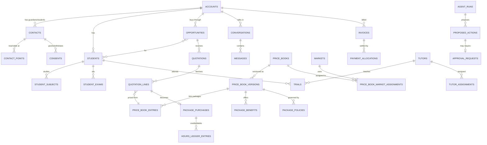

# 02: Database Schema Design

Status: **APPROVED 2026-11-10** (BD-032) · Database: PostgreSQL 17+ (CI also tests 16) · **Phase 1a tables exist** in migration `services/backend/migrations/versions/0001_foundation.py`: identity, reference data, settings values, audit log, and CRM accounts, contacts, contact points, consents, students, subjects, exams, scheduling preferences. **Phase 1b tables exist** in migration `0002_leads_pipeline.py`: lead sources, campaigns, leads, lead imports, duplicate candidates, merge records, opportunities (+ students, stage history), tasks, notes, tags, timeline activities, outbox, event consumptions, scheduled actions, dead letters. Pipeline stages and lost reasons are settings rather than tables (IN-08). Where this document and the migrations differ, the migrations are authoritative. All other tables are not created yet.

The DDL below is **illustrative**: it is meant to be read and reviewed. The authoritative schema will be Alembic migrations written in Phase 1, with tests.

## 0. Conventions

| Topic | Convention |
|-------|-----------|
| Primary keys | `id uuid`, UUIDv7 (time-ordered) generated by the application. `audit_log` uses `bigint` identity. |
| Timestamps | `timestamptz`, stored in UTC. `created_at`, `updated_at` on every mutable table. |
| Actors | Every write records `*_by_principal_id` → `principals(id)`. A **principal** is a user, an AI agent, the system or an integration, so "who did this" is always answerable. |
| Optimistic locking | `version int` on records people edit (`accounts`, `opportunities`, `quotations` …). |
| Money | `*_minor bigint` (integer minor units: pence, fils, cents, sen) **plus** `currency_code char(3)` FK → `currencies`. Never floats. Never an amount without a currency. |
| Enumerations | `text` + `CHECK` for fixed sets (easy to migrate); lookup tables for sets admins can configure (stages, sources, subjects). |
| Countries / languages / zones | ISO 3166-1 alpha-2 `char(2)`; BCP-47 language tags; IANA time-zone names (`Asia/Dubai`). |
| Phones / emails | Phones stored in E.164 (normalised with libphonenumber); emails in `citext`. |
| Soft delete | CRM records use `archived_at`. Legal erasure **anonymises** the record (replaces personal data) and writes an audit entry. |
| JSONB | Only for genuinely variable data (raw webhook payloads, rule definitions, snapshots). Each JSONB column with structure has a JSON Schema validated in the application. |
| Encryption | Credentials and restricted fields (e.g. learning-needs notes, tutor check documents) use application-level envelope encryption (`bytea` ciphertext + `key_id`). Disk encryption via the managed database. |

## 1. Core relationships (ERD)



---

## 2. Identity and access

```sql
principals (
  id uuid PK,
  kind text NOT NULL CHECK (kind IN ('user','agent','system','integration')),
  display_name text NOT NULL,
  is_active boolean NOT NULL DEFAULT true,
  created_at timestamptz NOT NULL
);

users (
  id uuid PK,
  principal_id uuid NOT NULL UNIQUE REFERENCES principals,
  email citext NOT NULL UNIQUE,
  full_name text NOT NULL,
  password_hash text NULL,              -- Argon2id; NULL when SSO-only
  status text NOT NULL CHECK (status IN ('invited','active','suspended','deactivated')),
  mfa_required boolean NOT NULL DEFAULT true,
  timezone text NOT NULL, locale text NOT NULL DEFAULT 'en-GB',
  last_login_at timestamptz, created_at, updated_at, version
);

user_mfa_factors (id, user_id FK, kind CHECK IN ('totp','webauthn'), secret_ciphertext bytea, key_id text,
                  label text, created_at, last_used_at);
user_sessions    (id, user_id FK, token_hash bytea UNIQUE, created_at, expires_at, last_seen_at,
                  ip inet, user_agent text, revoked_at);
roles            (id, key text UNIQUE, name, description, is_system boolean);
permissions      (key text PK,                -- e.g. 'pricing.version.approve'
                  description text);
role_permissions (role_id FK, permission_key FK, PRIMARY KEY (role_id, permission_key));
principal_roles  (principal_id FK, role_id FK, market_id uuid NULL REFERENCES markets,  -- optional market scope
                  granted_by, granted_at, PRIMARY KEY (principal_id, role_id, market_id));
teams            (id, name, description);
team_members     (team_id FK, user_id FK, team_role CHECK IN ('member','lead'), PRIMARY KEY (team_id, user_id));
```

## 3. Reference data

```sql
countries (
  code char(2) PK,                        -- ISO 3166-1 alpha-2
  name text NOT NULL,
  is_excluded boolean NOT NULL DEFAULT false,   -- seeded: US = true
  exclusion_reason text
);

currencies (code char(3) PK, name text, minor_units smallint NOT NULL,
            display_prefix text,          -- e.g. 'AED ', 'RM ', '£', '€', 'HKD ', 'USD '
            is_active boolean);

markets (
  id uuid PK,
  country_code char(2) NOT NULL UNIQUE REFERENCES countries,
  name text NOT NULL,
  status text NOT NULL CHECK (status IN ('planned','active','inactive')),
  default_timezone text NOT NULL,
  default_language text NULL,
  working_days smallint[] NULL,            -- ISO weekday numbers; configurable per market
  quiet_hours_start time NULL, quiet_hours_end time NULL,
  created_at, updated_at
);
-- Trigger: INSERT/UPDATE rejected when countries.is_excluded = true for country_code.

languages          (code text PK, name text, ai_reply_supported boolean NOT NULL DEFAULT false);
curricula          (id, code text UNIQUE,  -- 'IRISH','SABIS','AMERICAN','BRITISH'
                    name, is_active);
exam_boards        (id, curriculum_id FK, code, name, is_active);   -- CAMBRIDGE, PEARSON_EDEXCEL, AQA, OCR
qualifications     (id, curriculum_id FK, code, name, is_active);   -- IGCSE, GCSE, AS, A_LEVEL
board_qualification_offerings (exam_board_id FK, qualification_id FK,
                    offered_by_mixt boolean NULL,                    -- NULL = not yet confirmed (Q-ACA-02)
                    PRIMARY KEY (exam_board_id, qualification_id));
grade_levels       (id, curriculum_id FK, code, name, sort_order);   -- to be supplied (Q-ACA-03)
subjects           (id, code UNIQUE, name, is_active);
curriculum_subjects(curriculum_id FK, subject_id FK, qualification_id NULL FK, offered_by_mixt boolean NULL);
```

## 4. CRM

```sql
accounts (                                  -- a household (or, later, an institution)
  id uuid PK,
  account_number text NOT NULL UNIQUE,      -- human-friendly, e.g. MX-000123
  kind text NOT NULL CHECK (kind IN ('household','institution')),
  display_name text NOT NULL,
  country_of_residence char(2) NULL REFERENCES countries,
  market_id uuid NULL REFERENCES markets,   -- pricing market; set only when confirmed
  market_confirmed_by uuid NULL, market_confirmed_at timestamptz NULL,
  timezone text NULL, preferred_language text NULL REFERENCES languages,
  lifecycle_stage text NOT NULL CHECK (lifecycle_stage IN
      ('lead','prospect','customer','former_customer','disqualified','out_of_market')),
  owner_user_id uuid NULL REFERENCES users,
  first_touch_lead_source_id uuid NULL REFERENCES lead_sources,
  is_vip boolean NOT NULL DEFAULT false,
  status text NOT NULL CHECK (status IN ('active','archived','anonymised')),
  created_at, updated_at, archived_at, version
);

contacts (                                  -- people we talk to: guardians, payers, older students
  id uuid PK, account_id uuid NOT NULL REFERENCES accounts,
  role text NOT NULL CHECK (role IN ('guardian','payer','student','other')),
  first_name text, last_name text, preferred_name text,
  relationship_to_students text NULL,       -- 'mother','father','guardian','self', …
  is_primary boolean NOT NULL DEFAULT false,
  is_decision_maker boolean NULL,
  preferred_language text NULL, timezone text NULL,
  status, created_at, updated_at, archived_at, version
);
-- Partial unique index: one is_primary contact per account.

contact_points (
  id uuid PK, contact_id uuid NOT NULL REFERENCES contacts,
  kind text NOT NULL CHECK (kind IN ('phone','whatsapp','email','instagram','web_chat')),
  value text NOT NULL,                       -- normalised (E.164 / lower-case email / scoped id)
  is_primary boolean, is_verified boolean, verified_at timestamptz,
  status text NOT NULL CHECK (status IN ('active','bounced','invalid','opted_out')),
  created_at, updated_at
);
-- Index (kind, value) for duplicate detection; duplicates are flagged for merge, not hard-blocked.

consents (                                   -- append-only history; current state = latest row
  id uuid PK, contact_id uuid NOT NULL, contact_point_id uuid NULL,
  purpose text NOT NULL CHECK (purpose IN ('service_messages','marketing_whatsapp','marketing_email',
            'session_recording','ai_assisted_conversation','data_processing')),
  status text NOT NULL CHECK (status IN ('granted','withdrawn','denied')),
  legal_basis text NOT NULL CHECK (legal_basis IN ('consent','contract','legitimate_interests','legal_obligation')),
  source text NOT NULL,                      -- 'web_form','lead_ad_form','whatsapp_keyword','email_link','staff_logged','import'
  evidence jsonb NOT NULL,                   -- wording shown, form id, message id, IP, etc.
  captured_at timestamptz NOT NULL, captured_by_principal_id uuid NOT NULL
);

students (
  id uuid PK, account_id uuid NOT NULL REFERENCES accounts,
  contact_id uuid NULL REFERENCES contacts,  -- only if the student has their own contact points
  first_name text, last_name text, preferred_name text,
  birth_year smallint NULL,                  -- minimisation: year, not full DOB (Q-CMP-04)
  curriculum_id uuid NULL, grade_level_id uuid NULL,
  school_name text NULL, country_of_study char(2) NULL, timezone text NULL,
  goals text NULL,
  learning_needs_ciphertext bytea NULL, learning_needs_key_id text NULL,   -- restricted permission
  preferred_tutor_id uuid NULL REFERENCES tutors,
  status text NOT NULL CHECK (status IN ('prospective','active','paused','alumni')),
  created_at, updated_at, archived_at, version
);

student_subjects (
  id, student_id FK, subject_id FK,
  qualification_id NULL FK, exam_board_id NULL FK,
  current_grade text NULL, target_grade text NULL, priority smallint,
  status CHECK IN ('interested','active','completed','dropped'),
  created_at, updated_at
);

student_exams (
  id, student_id FK, student_subject_id NULL FK,
  exam_board_id NULL, qualification_id NULL,
  exam_session text NULL,                    -- e.g. 'May/June 2027'
  exam_date date NULL, paper_code text NULL,
  source CHECK IN ('customer','staff','ai_extracted'), is_confirmed boolean NOT NULL DEFAULT false,
  created_at, updated_at
);

scheduling_preferences (
  id, student_id FK UNIQUE, timezone text NOT NULL,
  preferred_weekdays smallint[], preferred_windows jsonb,     -- [{"start":"16:00","end":"19:00"}]
  lessons_per_week numeric(4,1) NULL, preferred_session_minutes smallint NULL,
  notes text, updated_at
);

tags          (id, name UNIQUE, color);
entity_tags   (tag_id FK, entity_type text, entity_id uuid, PRIMARY KEY (tag_id, entity_type, entity_id));
notes         (id, entity_type, entity_id, body text, visibility CHECK IN ('team','private','restricted'),
               author_principal_id, created_at, updated_at);
record_merges (id, entity_type, surviving_id, merged_id, snapshot jsonb, merged_by, merged_at);
```

## 5. Leads and pipeline

```sql
lead_sources (id, code UNIQUE,  -- meta_lead_ads, instagram_lead_ads, instagram_dm, website_form, website_chat,
                                -- whatsapp_inbound, email_inbound, referral, partner, manual, import
              name, is_active);

campaigns (id, lead_source_id FK, name, external_ref jsonb,      -- Meta campaign/adset/ad/form ids, UTM
           market_id NULL FK, starts_at, ends_at, status);

leads (
  id uuid PK, lead_source_id uuid NOT NULL, campaign_id uuid NULL,
  external_id text NULL,                     -- e.g. Meta leadgen_id
  inbound_webhook_event_id uuid NULL,
  submitted_name text, submitted_email citext, submitted_phone text, submitted_country char(2) NULL,
  submitted_message text, submitted_fields jsonb,   -- all form answers as received
  consent_text_shown text NULL,
  utm jsonb, landing_page text, referrer_url text,
  account_id uuid NULL, contact_id uuid NULL,
  status text NOT NULL CHECK (status IN ('new','matched','duplicate','out_of_market','spam','converted','rejected')),
  status_reason text NULL,
  received_at timestamptz NOT NULL, processed_at timestamptz NULL,
  UNIQUE (lead_source_id, external_id)
);

pipelines        (id, key UNIQUE CHECK IN ('new_business','renewal','upsell'), name);
pipeline_stages  (id, pipeline_id FK, key, name, sort_order,
                  stage_type CHECK IN ('open','won','lost'),
                  required_fields jsonb,     -- fields that must be filled before entering the stage
                  sla_hours int NULL, is_active, UNIQUE (pipeline_id, key));
lost_reasons     (id, code UNIQUE, name, is_active);

opportunities (
  id uuid PK, account_id uuid NOT NULL, pipeline_id uuid NOT NULL, stage_id uuid NOT NULL,
  kind text NOT NULL CHECK (kind IN ('new_business','renewal','upsell','sibling_addition','win_back')),
  title text, owner_user_id uuid NULL, market_id uuid NULL,
  estimated_amount_minor bigint NULL, estimated_currency char(3) NULL,     -- estimate only, never a price
  budget_amount_minor bigint NULL, budget_currency char(3) NULL, budget_notes text NULL,
  expected_close_date date NULL,
  lost_reason_id uuid NULL, lost_notes text NULL,
  source_lead_id uuid NULL, accepted_quotation_id uuid NULL,
  opened_at timestamptz NOT NULL, closed_at timestamptz NULL,
  created_at, updated_at, version,
  CHECK ((estimated_amount_minor IS NULL) = (estimated_currency IS NULL)),
  CHECK ((budget_amount_minor IS NULL) = (budget_currency IS NULL))
);

opportunity_students      (opportunity_id FK, student_id FK, PRIMARY KEY (opportunity_id, student_id));
opportunity_stage_history (id, opportunity_id FK, from_stage_id, to_stage_id, changed_by_principal_id,
                           proposed_action_id NULL, reason text, changed_at);
assignment_rules          (id, priority int, conditions jsonb,   -- market, language, source, VIP
                           strategy CHECK IN ('round_robin','least_loaded','fixed'),
                           target_team_id NULL, target_user_ids uuid[] NULL, is_active);
ownership_history         (id, entity_type, entity_id, from_user_id, to_user_id, changed_by_principal_id,
                           reason, changed_at);
```

## 6. Conversations and messaging

```sql
channel_accounts (
  id, channel CHECK IN ('whatsapp','email','instagram','web_chat'),
  provider CHECK IN ('meta_whatsapp_cloud','gmail','microsoft_graph','meta_instagram','mixt_webchat'),
  display_name, external_id text,            -- WhatsApp phone_number_id / mailbox address / IG account id
  provider_account_ref text NULL,            -- e.g. WABA id
  integration_connection_id FK, status, created_at
);

conversations (
  id uuid PK, channel_account_id uuid NOT NULL,
  account_id uuid NULL, contact_id uuid NULL,        -- NULL until matched to a CRM record
  external_thread_id text NULL,                      -- email thread id
  subject text NULL,
  status text NOT NULL CHECK (status IN ('open','pending_customer','pending_internal','closed')),
  handling_mode text NOT NULL DEFAULT 'ai_draft'
      CHECK (handling_mode IN ('ai_draft','ai_auto_low_risk','human_only')),
  human_takeover_by uuid NULL, human_takeover_at timestamptz NULL,
  assigned_user_id uuid NULL,
  last_inbound_at timestamptz, last_outbound_at timestamptz,
  service_window_expires_at timestamptz NULL,        -- WhatsApp customer-service window
  language text NULL,
  created_at, updated_at
);

messages (                                   -- partition by month on created_at when volume requires
  id uuid PK, conversation_id uuid NOT NULL, channel_account_id uuid NOT NULL,
  direction text NOT NULL CHECK (direction IN ('inbound','outbound')),
  sender_type text NOT NULL CHECK (sender_type IN ('customer','user','agent','system')),
  sender_principal_id uuid NULL,
  content_type text NOT NULL CHECK (content_type IN ('text','template','media','interactive','email','note')),
  body_text text NULL, body_html text NULL,
  template_id uuid NULL, template_variables jsonb NULL,
  provider_message_id text NULL,             -- wamid / Gmail id / Graph id
  in_reply_to_message_id uuid NULL,
  status text NOT NULL CHECK (status IN ('received','draft','pending_approval','queued','sending',
            'sent','delivered','read','failed','cancelled','blocked')),
  failure_code text NULL, failure_detail text NULL,
  agent_run_id uuid NULL, approval_request_id uuid NULL, quotation_id uuid NULL,
  idempotency_key text NULL UNIQUE,
  sent_at, delivered_at, read_at, created_at,
  UNIQUE (channel_account_id, provider_message_id)
);

message_attachments (id, message_id FK, storage_key, mime_type, size_bytes, sha256, provider_media_id,
                     malware_scan CHECK IN ('pending','clean','infected'));
message_status_events (id, message_id FK, status, provider_timestamp, error_code NULL, raw_event_id NULL, received_at);

message_templates (
  id, channel, channel_account_id NULL, name, language,
  category CHECK IN ('marketing','utility','authentication','email'),
  body text, variables_schema jsonb,
  provider_template_id NULL,
  provider_status CHECK IN ('not_submitted','submitted','approved','rejected','paused','disabled'),
  internal_status CHECK IN ('draft','approved','retired'),
  market_ids uuid[] NULL, version int, approved_by, created_at
);

suppression_list (id, kind CHECK IN ('phone','email'), value, reason CHECK IN
                  ('opt_out','bounce','complaint','legal','manual'), source, created_at, UNIQUE (kind, value));
```

## 7. Activities, tasks and follow-ups

```sql
activities (                                 -- the customer timeline (read model, fed by events)
  id, account_id FK, contact_id NULL, opportunity_id NULL, student_id NULL,
  type CHECK IN ('call','meeting','note','email','whatsapp','stage_change','quotation','trial',
                 'payment','escalation','system'),
  subject, body, occurred_at, actor_principal_id, ref_entity_type, ref_entity_id, metadata jsonb
);

tasks (
  id, account_id NULL, opportunity_id NULL,
  type CHECK IN ('follow_up','call','review_draft','approval','data_fix','payment_chase','renewal','other'),
  title, description, due_at, priority smallint,
  status CHECK IN ('open','in_progress','snoozed','done','cancelled'),
  assignee_principal_id,                     -- a user or an agent
  created_by_principal_id, sequence_enrollment_id NULL, completed_at, created_at, updated_at
);

follow_up_sequences (id, name, purpose CHECK IN ('post_enquiry','post_trial','post_quote','payment_pending',
                     'dormant','renewal','win_back'), stop_conditions jsonb, status CHECK IN ('draft','approved','retired'),
                     version, approved_by);
sequence_steps      (id, sequence_id FK, step_no, delay interval, channel,
                     action CHECK IN ('send_template','draft_ai_message','create_task'),
                     template_id NULL, conditions jsonb);
sequence_enrollments(id, sequence_id FK, account_id FK, opportunity_id NULL, current_step,
                     status CHECK IN ('active','paused','completed','stopped'), stop_reason, started_at, ended_at);
```

## 8. Pricing (full design in [04-pricing-engine](04-pricing-engine.md))

```sql
price_books (                                -- one "pricing sheet"
  id uuid PK, code text NOT NULL UNIQUE,     -- e.g. 'UK-GBP-TIER-A'
  name text NOT NULL,
  currency_code char(3) NOT NULL REFERENCES currencies,
  plan_type text NOT NULL CHECK (plan_type IN ('standard','premium','promotional','custom')),
  tier_label text NULL,                      -- 'Tier A', 'Schedule B', …
  unit_type text NOT NULL CHECK (unit_type IN ('hour','class')),
  audience text NOT NULL CHECK (audience IN ('public','restricted')),  -- restricted = only via customer assignment
  description text, created_at, archived_at
);

price_book_versions (
  id uuid PK, price_book_id uuid NOT NULL, version_no int NOT NULL,
  status text NOT NULL CHECK (status IN ('draft','in_review','approved','active','superseded','retired','rejected')),
  change_type text NOT NULL DEFAULT 'initial' CHECK (change_type IN ('initial','correction','price_change')),
  supersedes_version_id uuid NULL REFERENCES price_book_versions,   -- required when change_type = 'correction'
  figures_confirmation text NOT NULL CHECK (figures_confirmation IN ('supplied_unverified','confirmed')),
  session_minutes_per_unit smallint NOT NULL DEFAULT 60,
  tax_treatment text NOT NULL DEFAULT 'unknown' CHECK (tax_treatment IN ('unknown','inclusive','exclusive','not_applicable')),
  effective_from timestamptz NULL, effective_to timestamptz NULL,
  source_document text NOT NULL, source_received_on date NOT NULL, change_summary text,
  submitted_by uuid, approved_by uuid NULL, second_approved_by uuid NULL, approved_at timestamptz NULL,
  activated_by uuid NULL, activated_at timestamptz NULL,
  content_hash text NULL,                    -- SHA-256 of canonical entries+benefits+policies, set at approval
  created_at,
  UNIQUE (price_book_id, version_no),
  CHECK (change_type <> 'correction' OR supersedes_version_id IS NOT NULL),
  EXCLUDE USING gist (price_book_id WITH =, tstzrange(effective_from, effective_to) WITH &&)
     WHERE (status = 'active')
);

price_book_entries (
  id uuid PK, price_book_version_id uuid NOT NULL,
  package_code text NOT NULL,                -- e.g. '15H', '20C'
  display_name text NOT NULL,
  quantity numeric(8,2) NOT NULL CHECK (quantity > 0),          -- hours or classes
  package_total_minor bigint NOT NULL CHECK (package_total_minor > 0),
  advertised_unit_rate_minor bigint NULL,    -- only when the source states an hourly/class rate
  derived_unit_rate_minor bigint GENERATED ALWAYS AS (round(package_total_minor / quantity)) STORED,  -- info only
  is_purchasable boolean NOT NULL DEFAULT true,
  sort_order smallint,
  UNIQUE (price_book_version_id, quantity),
  UNIQUE (price_book_version_id, package_code)
);

price_book_market_assignments (
  id uuid PK, price_book_id uuid NOT NULL, market_id uuid NOT NULL,
  assignment_status text NOT NULL CHECK (assignment_status IN ('unconfirmed','confirmed','revoked')),
  is_market_default boolean NOT NULL DEFAULT false,  -- trigger: max one default per (market, plan_type)
  eligibility_rule_id uuid NULL REFERENCES pricing_rules,
  confirmed_by uuid NULL, confirmed_at timestamptz NULL, notes text,
  UNIQUE (price_book_id, market_id)
);

benefit_definitions (id, code UNIQUE, name, description, kind CHECK IN ('benefit','policy'));

package_benefits (
  id, price_book_version_id FK, price_book_entry_id NULL FK,   -- NULL = applies to all entries of the version
  benefit_definition_id FK, customer_facing_text text NOT NULL, sort_order,
  copied_from_id NULL, cross_market_copy_approved_by NULL,     -- required when copied from another market
  status CHECK IN ('draft','approved')
);

package_policies (
  id, price_book_version_id FK, price_book_entry_id NULL FK,
  policy_type text NOT NULL CHECK (policy_type IN ('validity_months','no_expiry','pause_resume',
     'max_subjects','unlimited_subjects','family_sharing','recorded_sessions','progress_reports',
     'parent_meetings','refund_or_swap_guarantee','minimum_purchase','other')),
  value jsonb NOT NULL,                      -- validated per type, e.g. {"months":18}
  customer_facing_text text NOT NULL, terms_url text NULL,
  copied_from_id NULL, cross_market_copy_approved_by NULL,
  status CHECK IN ('draft','approved'), approved_by
);

pricing_rules (id, code UNIQUE, kind CHECK IN ('eligibility','minimum_purchase','availability'),
               definition jsonb NOT NULL,    -- validated rule language (see 04 §8)
               description, status CHECK IN ('draft','approved','retired'), version, approved_by);

promotions (
  id, code UNIQUE, name, description,
  kind CHECK IN ('percent_off','amount_off','bonus_units','promotional_price_book'),
  value jsonb NOT NULL, promotional_price_book_id NULL,
  eligibility_rule_id NULL, stackable boolean NOT NULL DEFAULT false,
  starts_at timestamptz NOT NULL, ends_at timestamptz NOT NULL,      -- every promotion must expire
  max_redemptions int NULL, max_per_account int NOT NULL DEFAULT 1,
  status CHECK IN ('draft','in_review','approved','active','expired','cancelled'),
  approved_by, approved_at, created_at,
  CHECK (ends_at > starts_at)
);
promotion_targets     (promotion_id FK, price_book_version_id NULL, price_book_entry_id NULL, market_id NULL);
promotion_redemptions (id, promotion_id FK, account_id FK, quotation_id FK, redeemed_at);

customer_pricing_assignments (               -- special/confidential pricing; never created by AI
  id, account_id FK, price_book_id FK,
  reason text NOT NULL, is_confidential boolean NOT NULL DEFAULT true,
  valid_from timestamptz NOT NULL, valid_to timestamptz NULL,
  status CHECK IN ('pending_approval','active','expired','revoked'),
  requested_by, approved_by, approved_at, created_at
);

pricing_tier_selections (                    -- a PERSON's choice between valid tiers/schedules (ADR-12)
  id uuid PK, account_id uuid NOT NULL, opportunity_id uuid NULL,    -- NULL = applies to the whole account
  market_id uuid NOT NULL, price_book_id uuid NOT NULL,
  reason text NOT NULL,
  selected_by_user_id uuid NOT NULL REFERENCES users,                -- users only: agents cannot select (DB-12)
  selected_at timestamptz NOT NULL, valid_until timestamptz NULL,
  status text NOT NULL CHECK (status IN ('active','replaced','revoked')),
  replaced_by_id uuid NULL
);
-- Partial unique index: one active selection per (account, opportunity, market, plan type) (plan type via trigger).

discount_authority_rules (id, role_id FK, market_id NULL, max_discount_pct numeric(5,2),
                          max_discount_minor bigint NULL, currency_code NULL, requires_second_approver boolean);

pricing_import_batches (id, file_storage_key, uploaded_by, uploaded_at,
                        status CHECK IN ('uploaded','validated','invalid','applied','discarded'),
                        target_price_book_id NULL, validation_report jsonb, diff jsonb);
pricing_import_rows    (id, batch_id FK, row_no, raw jsonb, parsed jsonb, errors jsonb);
```

## 9. Quotations and approvals

```sql
quotations (
  id uuid PK, quote_number text NOT NULL, revision_no int NOT NULL DEFAULT 1,
  parent_quotation_id uuid NULL,             -- previous revision
  account_id uuid NOT NULL, opportunity_id uuid NOT NULL, market_id uuid NOT NULL,
  currency_code char(3) NOT NULL,
  status text NOT NULL CHECK (status IN ('draft','pending_approval','approved','issued','viewed',
          'accepted','declined','expired','superseded','cancelled')),
  valid_until date NOT NULL,
  subtotal_minor bigint NOT NULL, discount_total_minor bigint NOT NULL DEFAULT 0,
  tax_minor bigint NULL, total_minor bigint NOT NULL, tax_treatment text NOT NULL,
  pricing_snapshot jsonb NOT NULL, snapshot_hash text NOT NULL,
  prepared_by_principal_id uuid NOT NULL, approval_request_id uuid NULL,
  issued_at, issued_via, accepted_at, accepted_via,
  customer_note text, internal_note text, document_storage_key text NULL,
  created_at, updated_at, version,
  UNIQUE (quote_number, revision_no)
);

quotation_lines (                            -- immutable once the quotation leaves 'draft' (trigger)
  id, quotation_id FK, line_no, student_id NULL,
  price_book_id NOT NULL, price_book_code text NOT NULL,
  price_book_version_id NOT NULL, price_book_version_no int NOT NULL,
  price_book_entry_id NOT NULL, package_code text NOT NULL,
  plan_type text NOT NULL, tier_label text NULL,
  quantity numeric(8,2) NOT NULL, unit_type text NOT NULL, session_minutes_per_unit smallint NOT NULL,
  list_total_minor bigint NOT NULL,
  discount_minor bigint NOT NULL DEFAULT 0, promotion_id NULL,
  final_total_minor bigint NOT NULL, currency_code char(3) NOT NULL,
  is_custom boolean NOT NULL DEFAULT false, custom_reason text NULL,
  benefits_snapshot jsonb NOT NULL, policies_snapshot jsonb NOT NULL,
  CHECK (final_total_minor = list_total_minor - discount_minor),
  CHECK (NOT is_custom OR custom_reason IS NOT NULL)
);

approval_policies (
  id, action_type text NOT NULL,             -- 'send_message','issue_quotation','apply_discount', …
  conditions jsonb,                          -- e.g. {"principal_kind":"agent","market":"AE","discount_pct_gt":0}
  required_level CHECK IN ('auto','auto_notify','approval','dual_approval','human_only','forbidden'),
  approver_role_ids uuid[], priority int, is_active, version, updated_by, updated_at
);

approval_requests (
  id, action_type, subject_entity_type, subject_entity_id,
  proposed_action_id NULL, requested_by_principal_id,
  payload jsonb NOT NULL, payload_hash text NOT NULL,     -- exactly what will run if approved
  required_approvals smallint NOT NULL DEFAULT 1,
  status CHECK IN ('pending','approved','rejected','expired','executed','failed','cancelled'),
  expires_at, created_at
);

approval_decisions (id, approval_request_id FK, decided_by_user_id FK,
                    decision CHECK IN ('approve','reject','approve_with_edits'),
                    edited_payload jsonb NULL, comment, decided_at,
                    UNIQUE (approval_request_id, decided_by_user_id));
```

## 10. Tutors, trials and lessons

```sql
tutors (
  id, principal_id NULL,                     -- if tutors get a login later
  first_name, last_name, email citext, phone text,
  status CHECK IN ('applicant','active','inactive','offboarded'),
  employment_type text NULL, timezone text NOT NULL,
  bio_internal text, bio_customer_facing text,
  max_weekly_hours numeric(5,1) NULL,
  rating_avg numeric(3,2) NULL, rating_count int NOT NULL DEFAULT 0,
  cost_rate_minor bigint NULL, cost_currency char(3) NULL,     -- restricted field
  created_at, updated_at, version
);
tutor_capabilities (id, tutor_id FK, curriculum_id FK, subject_id FK, exam_board_id NULL, qualification_id NULL,
                    grade_level_min_id NULL, grade_level_max_id NULL, experience_years numeric(4,1),
                    is_verified boolean, verified_by NULL);
tutor_languages (tutor_id FK, language_code FK, proficiency CHECK IN ('native','fluent','working'));
tutor_compliance_checks (id, tutor_id FK,
                    check_type CHECK IN ('identity','background_check','safeguarding_training','qualification','right_to_work'),
                    jurisdiction char(2) NULL, status CHECK IN ('pending','passed','failed','expired'),
                    reference_ciphertext bytea NULL, checked_at, expires_at, document_storage_key NULL);
tutor_availability_rules      (id, tutor_id FK, weekday smallint, start_time time, end_time time,
                               timezone text, valid_from date, valid_to date NULL);
tutor_availability_exceptions (id, tutor_id FK, starts_at, ends_at, kind CHECK IN ('unavailable','extra'), reason);
tutor_assignments (id, student_id FK, student_subject_id FK, tutor_id FK,
                   status CHECK IN ('proposed','active','ended'), proposed_by_principal_id, approved_by,
                   started_at, ended_at, end_reason);
match_recommendations (id, agent_run_id FK, student_subject_id FK, tutor_id FK, rank smallint, score numeric,
                       score_breakdown jsonb, rationale text,
                       decision CHECK IN ('accepted','rejected') NULL, decided_by NULL, created_at);

trials (
  id, account_id FK, student_id FK, student_subject_id FK, opportunity_id FK, tutor_id NULL FK,
  status CHECK IN ('requested','proposed','scheduled','completed','no_show_student','no_show_tutor',
                   'cancelled','rescheduled'),
  scheduled_start timestamptz NULL, scheduled_end timestamptz NULL, customer_timezone text,
  duration_minutes smallint, is_free boolean NOT NULL,
  meeting_url text NULL, calendar_event_id NULL,
  outcome CHECK IN ('positive','neutral','negative') NULL,
  tutor_feedback text NULL, customer_feedback text NULL,
  created_by_principal_id, created_at, updated_at
);

lessons (
  id, package_purchase_id NULL FK, student_id FK, tutor_id FK, student_subject_id FK,
  scheduled_start, scheduled_end,
  status CHECK IN ('scheduled','completed','cancelled_customer','cancelled_tutor','no_show','late_cancel'),
  units_charged numeric(6,2) NULL,
  source CHECK IN ('mixt_ai','external_import'), external_ref text NULL,
  created_at, updated_at
);
calendar_events (id, provider CHECK IN ('google','microsoft'), owner_type, owner_id, external_event_id,
                 etag, trial_id NULL, lesson_id NULL, sync_status, updated_at);
```

## 11. Enrolment and hours ledger

```sql
package_purchases (
  id, account_id FK, quotation_id FK, quotation_line_id FK UNIQUE, invoice_id NULL,
  price_book_version_id FK, price_book_entry_id FK,
  quantity_purchased numeric(8,2) NOT NULL, unit_type text NOT NULL,
  amount_minor bigint NOT NULL, currency_code char(3) NOT NULL,
  status CHECK IN ('pending_payment','active','paused','exhausted','expired','refunded','cancelled'),
  activated_at NULL, expires_at NULL,       -- computed from the version's validity policy at activation
  policies_snapshot jsonb NOT NULL, created_at, updated_at
);

hours_ledger_entries (                       -- append-only; balance = SUM(quantity)
  id, package_purchase_id FK, student_id NULL FK,
  entry_type CHECK IN ('purchase_credit','bonus_credit','lesson_debit','late_cancel_debit',
                       'adjustment','expiry','refund_reversal','transfer_in','transfer_out'),
  quantity numeric(8,2) NOT NULL,            -- signed: credits > 0, debits < 0
  lesson_id NULL, reason text, approval_request_id NULL,
  created_by_principal_id NOT NULL, created_at NOT NULL
);
-- Invariant (service + deferred trigger): balance never below 0 without an approved adjustment.

package_pauses           (id, package_purchase_id FK, starts_on date, ends_on date NULL, reason, approved_by);
package_allowed_students (package_purchase_id FK, student_id FK, PRIMARY KEY (...));  -- only if family sharing policy applies
```

## 12. Payments

```sql
invoices (
  id, invoice_number UNIQUE, account_id FK, quotation_id NULL FK,
  currency_code char(3) NOT NULL, subtotal_minor, tax_minor NULL, total_minor NOT NULL,
  status CHECK IN ('draft','issued','partially_paid','paid','overdue','void','refunded'),
  issued_at, due_at, provider NULL, provider_invoice_id NULL, payment_link_url NULL,
  pdf_storage_key NULL, created_at, updated_at, version
);
invoice_lines (id, invoice_id FK, quotation_line_id NULL, description, quantity, amount_minor);

payments (
  id, account_id FK,
  method CHECK IN ('card','bank_transfer','local_method','cash','other'),
  provider text NULL, provider_payment_id text NULL,
  amount_minor bigint NOT NULL, currency_code char(3) NOT NULL,
  status CHECK IN ('pending','succeeded','failed','refunded','partially_refunded','disputed'),
  verification CHECK IN ('provider_webhook','finance_confirmed') NOT NULL,
  recorded_by_principal_id NOT NULL, evidence_storage_key NULL,
  received_at, created_at,
  UNIQUE (provider, provider_payment_id)
);
payment_allocations (payment_id FK, invoice_id FK, amount_minor bigint NOT NULL,
                     PRIMARY KEY (payment_id, invoice_id));
-- Trigger: payment currency = invoice currency. No currency conversion inside the system.
refunds (id, payment_id FK, amount_minor, reason, status CHECK IN ('requested','approved','processed','rejected'),
         approved_by, provider_refund_id NULL, created_at, processed_at);
```

## 13. Retention, feedback and referrals

```sql
health_scores     (id, account_id FK, computed_at, score smallint CHECK (score BETWEEN 0 AND 100),
                   band CHECK IN ('healthy','watch','at_risk'), factors jsonb, model_version text);
feedback_responses(id, account_id FK, student_id NULL, lesson_id NULL, trial_id NULL,
                   kind CHECK IN ('nps','csat','lesson_rating','free_text'), score smallint NULL,
                   comment text, channel, received_at);
referral_programs (id, name, reward_definition jsonb, eligibility_rule_id NULL,
                   status CHECK IN ('draft','approved','active','ended'), starts_at, ends_at, approved_by);
referral_codes    (id, program_id FK, referrer_account_id FK, code text UNIQUE, created_at);
referrals         (id, program_id FK, referral_code_id NULL, referrer_account_id FK,
                   referred_lead_id NULL, referred_account_id NULL,
                   status CHECK IN ('submitted','qualified','converted','rewarded','rejected'),
                   converted_quotation_id NULL, created_at, updated_at);
referral_rewards  (id, referral_id FK, kind CHECK IN ('bonus_hours','account_credit','gift','other'),
                   value jsonb, status CHECK IN ('pending_approval','approved','issued','cancelled'),
                   approved_by, issued_at, hours_ledger_entry_id NULL);
```

## 14. AI runtime and knowledge

```sql
model_profiles   (key text PK,               -- 'conversation_primary','extraction_fast','summarise', …
                  provider CHECK IN ('anthropic','openai'), model text, params jsonb,
                  fallback_profile_key NULL, is_active, updated_by, updated_at);
prompt_versions  (id, key, version_no, content text, variables jsonb, change_note, created_by, created_at,
                  UNIQUE (key, version_no));
agent_definitions(id, key UNIQUE, name, description, principal_id FK UNIQUE,
                  is_enabled boolean NOT NULL DEFAULT false, disabled_reason text NULL);
agent_versions   (id, agent_definition_id FK, version_no, model_profile_key FK, prompt_version_id FK,
                  tool_keys text[], data_scopes text[], max_steps smallint, max_input_tokens int,
                  max_cost_micros bigint, config jsonb,
                  status CHECK IN ('draft','eval_passed','active','retired'),
                  eval_run_id NULL, activated_by, activated_at);

agent_runs (
  id, agent_version_id FK, trigger_type CHECK IN ('event','schedule','user_request'), trigger_ref text,
  account_id NULL, conversation_id NULL,     -- the run's data scope
  status CHECK IN ('queued','running','succeeded','failed','escalated','cancelled','budget_exceeded'),
  started_at, finished_at, input_tokens int, output_tokens int, cost_micros bigint,
  error_code NULL, error_detail NULL, correlation_id
);
agent_steps (id, agent_run_id FK, step_no, kind CHECK IN ('llm_call','tool_call','guardrail','decision'),
             name, input_redacted jsonb, output_redacted jsonb, status, latency_ms, created_at);
llm_calls   (id, agent_run_id NULL, model_profile_key, provider, model,
             input_tokens, output_tokens, cache_read_tokens, latency_ms, status, error NULL,
             cost_micros bigint, payload_ciphertext bytea NULL, payload_expires_at, created_at);

proposed_actions (
  id, agent_run_id FK, action_type, payload jsonb NOT NULL, payload_hash text NOT NULL,
  rationale text, confidence numeric(4,3) NULL,
  guardrail_results jsonb NOT NULL,
  policy_decision CHECK IN ('auto','auto_notify','approval','dual_approval','human_only','forbidden'),
  approval_request_id NULL,
  status CHECK IN ('proposed','blocked','pending_approval','executed','rejected','failed'),
  executed_at NULL, result_ref NULL, created_at
);

escalations (
  id, account_id NULL, conversation_id NULL, agent_run_id NULL,
  reason_code CHECK IN ('pricing_unavailable','tier_decision_required','discount_request','custom_quote',
     'complaint','refund_request','safeguarding','legal','human_requested','low_confidence','out_of_market',
     'policy_question','payment_dispute','repeated_failure','other'),
  severity CHECK IN ('low','normal','high','urgent'),
  summary text NOT NULL, assigned_user_id NULL,
  status CHECK IN ('open','acknowledged','resolved'), sla_due_at, resolved_at, resolution_note, created_at
);

conversation_summaries (id, conversation_id FK, summary_text, covers_until_message_id, model_profile_key, created_at);

extracted_facts (                            -- AI-extracted CRM data with provenance
  id, account_id FK, student_id NULL, field_path text NOT NULL,   -- e.g. 'student_exams.exam_date'
  value jsonb NOT NULL, source_message_id FK, agent_run_id FK, confidence numeric(4,3),
  status CHECK IN ('proposed','applied','confirmed','rejected'), decided_by NULL, created_at
);

knowledge_documents (id, key, title,
                     category CHECK IN ('curriculum','faq','objection','policy','process','market'),
                     market_id NULL, curriculum_id NULL, language, body_markdown,
                     version_no, status CHECK IN ('draft','approved','retired'), approved_by, approved_at);
knowledge_chunks    (id, document_id FK, chunk_no, content text, embedding vector, embedding_model text);
eval_runs           (id, suite_key, agent_version_id NULL, prompt_version_id NULL, started_at, finished_at,
                     passed int, failed int, report_storage_key, status);
```

## 15. Integrations and reliability

```sql
integration_connections (id, provider, display_name,
                         status CHECK IN ('pending','connected','error','disconnected'),
                         config jsonb,       -- non-secret settings only
                         scopes text[], connected_by, connected_at, last_success_at, last_error);
integration_credentials (id, connection_id FK,
                         kind CHECK IN ('access_token','refresh_token','app_secret','webhook_secret','api_key','client_secret'),
                         ciphertext bytea NOT NULL, key_id text NOT NULL, expires_at NULL, rotated_at, created_at);
                         -- never returned by any API; decrypted only inside integration adapters

inbound_webhook_events (
  id, provider text NOT NULL, external_event_id text NOT NULL,
  signature_valid boolean NOT NULL, headers_redacted jsonb, payload jsonb NOT NULL,
  status CHECK IN ('received','processing','processed','ignored','failed','dead'),
  attempts int NOT NULL DEFAULT 0, last_error NULL, received_at, processed_at,
  UNIQUE (provider, external_event_id)
);

outbox_events      (id, event_type, aggregate_type, aggregate_id, payload jsonb, occurred_at,
                    dispatched_at NULL, attempts int);
event_consumptions (consumer text, event_id uuid, processed_at, PRIMARY KEY (consumer, event_id));
scheduled_actions  (id, action_type, payload jsonb, due_at, dedupe_key text UNIQUE NULL,
                    status CHECK IN ('pending','claimed','done','cancelled','failed'),
                    claimed_at, attempts, created_by_principal_id, created_at);
dead_letters       (id, source CHECK IN ('job','webhook','outbox'), ref_id, task_name, payload jsonb,
                    error text, failed_at, replayed_at NULL, replayed_by NULL);
idempotency_keys   (key text, principal_id uuid, request_hash text, response jsonb, created_at, expires_at,
                    PRIMARY KEY (principal_id, key));
sync_cursors       (connection_id FK, resource text, cursor text, updated_at,      -- Gmail historyId, Graph deltaLink
                    PRIMARY KEY (connection_id, resource));

-- Configurable settings for outstanding business decisions (ADR-11; register in doc 13)
setting_definitions (
  key text PK,                               -- e.g. 'pricing.tier_selection_mode'
  description text NOT NULL,
  value_schema jsonb NOT NULL,               -- JSON Schema; values are validated against it
  safe_default jsonb NOT NULL,
  allowed_scopes text[] NOT NULL,            -- global, market, price_book, price_book_version, channel, agent, role
  change_permission text NOT NULL REFERENCES permissions,
  requires_dual_approval boolean NOT NULL DEFAULT false,
  open_question_ref text NULL                -- e.g. 'Q-PRC-02'
);
system_settings (
  id uuid PK, key text NOT NULL REFERENCES setting_definitions,
  scope_type text NOT NULL, scope_id uuid NULL,
  value jsonb NOT NULL,
  status text NOT NULL CHECK (status IN ('safe_default','confirmed')),
  decision_ref text NULL,                    -- e.g. 'BD-012'; required when status = 'confirmed'
  updated_by uuid NOT NULL, updated_at timestamptz NOT NULL, version int NOT NULL,
  UNIQUE (key, scope_type, scope_id),
  CHECK (status <> 'confirmed' OR decision_ref IS NOT NULL)
);
```

## 16. Audit and privacy

```sql
audit_log (                                  -- append-only; monthly partitions; UPDATE/DELETE revoked
  id bigint GENERATED ALWAYS AS IDENTITY, occurred_at timestamptz NOT NULL,
  actor_principal_id uuid NOT NULL, actor_kind text NOT NULL,
  approved_by_user_id uuid NULL,             -- when an agent action was approved by a person
  action text NOT NULL,                      -- create, update, delete, approve, send, login, export, …
  entity_type text NOT NULL, entity_id uuid NULL,
  changes jsonb NULL,                        -- changed fields before/after; sensitive fields masked
  ip inet NULL, user_agent text NULL, correlation_id text,
  prev_hash bytea NULL, row_hash bytea NOT NULL    -- hash chain makes tampering detectable
);

data_subject_requests (id, contact_id FK, kind CHECK IN ('access','rectification','erasure','restriction',
                       'objection','portability'), jurisdiction char(2), received_at, due_at,
                       status, handled_by, export_storage_key NULL, notes);
retention_policies    (id, entity_type, retain_days int, action CHECK IN ('delete','anonymise'),
                       legal_basis_note, is_active);
legal_holds           (id, account_id FK, reason, placed_by, placed_at, released_at NULL);
```

---

## 17. Integrity rules enforced inside the database

| # | Rule | Mechanism |
|---|------|-----------|
| DB-01 | No market can be created for an excluded country (US). | Trigger on `markets` checking `countries.is_excluded` |
| DB-02 | An approved/active price-book version and its entries, benefits and policies cannot be edited. | Trigger blocks UPDATE/DELETE unless status is `draft` (status-only transitions allowed) |
| DB-03 | Two active versions of the same price book cannot overlap in time. | `EXCLUDE USING gist` on effective range |
| DB-04 | A version can only become `active` if `figures_confirmation = 'confirmed'`, `tax_treatment <> 'unknown'`, it has at least one entry, and the price book has at least one **confirmed** market assignment. | Trigger (the service layer also enforces the full activation gate) |
| DB-05 | At most one default price book per (market, plan type); a `promotional` price book can never be a market default. | Trigger on `price_book_market_assignments` |
| DB-06 | Quotation lines are immutable after the quotation leaves `draft`. | Trigger |
| DB-07 | Quotation line currency = quotation currency = price book currency. | Trigger |
| DB-08 | Payment currency = invoice currency. | Trigger |
| DB-09 | `audit_log`, `consents`, `hours_ledger_entries` are append-only. | `REVOKE UPDATE, DELETE` from the app role; separate migration role |
| DB-10 | Provider IDs are unique (no duplicate messages, leads, payments). | Unique constraints |
| DB-11 | Promotions must have an end date after their start date. | `CHECK` |
| DB-12 | Only users (never agent principals) can create `pricing_tier_selections` or `customer_pricing_assignments`. | Trigger checks `principals.kind = 'user'` + permission check in service |
| DB-13 | A correction version must reference the version it supersedes; the superseded version's entries remain unchanged (DB-02). | `CHECK` + DB-02 trigger |
| DB-14 | Promotions and promotional books never write to standard `price_book_entries`. | No write path in the promotion service; DB-02 trigger; test (04 §18) |
| DB-15 | A setting cannot be marked `confirmed` without a decision-log reference. | `CHECK` on `system_settings` |

## 18. Indexing and partitioning (initial)

- Foreign keys indexed. Composite indexes for the main screens: `opportunities (owner_user_id, stage_id)`, `messages (conversation_id, created_at DESC)`, `tasks (assignee_principal_id, status, due_at)`, `scheduled_actions (status, due_at)`, `outbox_events (dispatched_at) WHERE dispatched_at IS NULL`.
- Trigram (`pg_trgm`) indexes for search on names, emails and phone numbers.
- `pgvector` HNSW index on `knowledge_chunks.embedding`.
- Monthly range partitions (when volume requires): `messages`, `message_status_events`, `audit_log`, `llm_calls`, `inbound_webhook_events`.

## 19. Seed data policy

- Reference seeds: the **13 operating markets** (BD-004; `status = 'active'`, while each market's Mixt AI rollout is a separate setting, `markets.mixt_ai_rollout = off`), the **US as an excluded country only** (BD-005), currencies, the **four confirmed curricula** (Irish, SABIS, American, British: BD-007; **no IB**, BD-008), the four British exam boards and four qualifications **exactly as supplied** (BD-009).
- Pricing seeds: the 13 supplied price books (91 entries) are loaded as **`draft`** versions with `figures_confirmation = 'confirmed'` (figures confirmed by Mixt) but **no confirmed market assignments for USD**, `tax_treatment = 'unknown'` everywhere, and **nothing active** (see [05](05-pricing-data-register.md)).
- Pricing seed details (v0.2): `IE-EUR-SCHEDULE-A` with `unit_type = 'class'`, `session_minutes_per_unit = 60` (BD-011); UK, UAE and Ireland markets with `pricing.tier_selection_mode = manual` (safe default); `MY-MYR` as **version 1** (`change_type = 'initial'`), with a corrected set, if supplied, loaded as version 2 (`correction`) (BD-015, Q-PRC-21).
- Settings seeds: every setting in [13](13-configurable-settings.md) with its safe default; settings already confirmed by Mixt carry their `BD-` reference.
- No invented grade levels, subjects, benefit assignments, promotions, tier rules or tutors are seeded.
