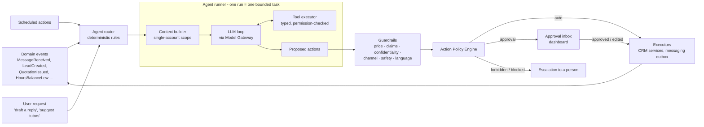
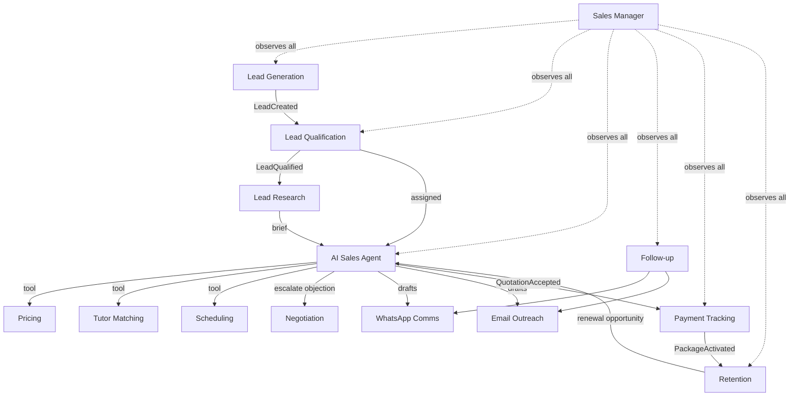

# 03: AI Agent Architecture

Status: **PROPOSAL, awaiting approval** · No agent is implemented.

## 1. Design approach

Mixt AI's agents are **specialised workers on one shared CRM**, not separate chatbots.

- **Deterministic orchestration.** Code (not an LLM) decides *which* agent runs, *when*, and *on what data*: event routing, schedules and state machines.
- **LLM proposes, policy decides.** Agents read through tools and **propose** actions. The **Action Policy Engine** decides whether an action runs automatically, waits for a person's approval, or is refused.
- **Deterministic cores where correctness matters.** Pricing, tutor eligibility, slot finding, payment reconciliation, hours balances and health scores are ordinary code. The agent wrapped around each core explains, recommends and drafts; it does not compute the critical result.
- **No hidden state.** Agents share information only through CRM records, domain events and typed tool calls, never free-form agent-to-agent chat. Everything is logged.

## 2. Runtime overview



## 3. Agent definition contract

Every agent is defined as data (`agent_definitions` + versioned `agent_versions`) and registered in code with its tools. Example:

```yaml
key: sales_agent
principal: agent:sales_agent            # non-human identity used in audit and permission checks
version: 7
model_profile: conversation_primary     # resolved by the Model Gateway (e.g. Claude, with OpenAI fallback)
prompt_version: sales_agent.system@12
data_scope: single_account              # the run can only see the triggering account
tools:
  read:  [crm.get_account_context, crm.get_student_profiles, conversations.get_history,
          knowledge.search, pricing.get_eligible_options, scheduling.find_trial_slots,
          tutors.get_match_shortlist]
  propose: [messages.draft_reply, quotations.create_draft, trials.propose,
            crm.propose_fact_updates, tasks.create, escalations.create]
limits: { max_steps: 12, max_input_tokens: 60000, max_cost: "configurable", timeout_s: 90 }
escalate_on: [pricing_unavailable, tier_decision_required, discount_request, complaint,
              refund_request, safeguarding, legal, human_requested, low_confidence, out_of_market]
never: [state_unlisted_price, promise_unapproved_benefit, mention_other_customers,
        assign_pricing_tier, confirm_payment, contact_without_consent]
```

Changing a prompt, tool list or model profile creates a **new agent version**. A version must **pass the evaluation suite** before activation (§13).

## 4. Model Gateway (Claude + OpenAI)

```python
class ModelGateway(Protocol):
    def generate(self, *, profile: str, system: str, messages: list[Message],
                 tools: list[ToolSpec] | None = None,
                 response_schema: type[BaseModel] | None = None,
                 metadata: CallMetadata) -> ModelResult: ...
```

- **Adapters:** `AnthropicAdapter` (Claude API) and `OpenAIAdapter` (OpenAI API) turn one internal message/tool format into each provider's format. Agents never import a provider SDK directly.
- **Model profiles** (stored in `model_profiles`): e.g. `conversation_primary`, `extraction_fast`, `summarise`, `classify`, `embed`. Each names a provider, model and parameters, plus a **fallback profile**. The exact models are a configuration choice, tested by the eval suite before switching.
- **Structured outputs:** extraction and classification return Pydantic-validated JSON; invalid output is retried once with the validation error, then the run fails safely.
- **Reliability:** timeouts, retries with backoff for transient errors, a circuit breaker per provider, automatic fallback, and the reason for every fallback logged.
- **Cost control:** token and cost accounting per call (`llm_calls`), per-run budgets, daily budget alerts; prompt caching where the provider supports it for long, stable system prompts and knowledge context.
- **Data handling:** only the minimum necessary customer data is sent; no payment card data ever; provider data-retention terms reviewed and the strictest available option chosen (Q-CMP-06).

## 5. Context building and data isolation

The **context builder** is the main protection against one customer's data reaching another.

1. Every run has a **scope**: normally `account_id` (plus `conversation_id`). The scope is set by the router from the triggering event, **never by the LLM**.
2. Every read tool takes its scope from the run context, not from model-supplied arguments. A model cannot ask for "account X". A tool that receives an ID outside the scope returns `SCOPE_VIOLATION`, and the attempt is logged and alerted.
3. Pricing tools return only (a) public price books for the account's **confirmed** market and (b) this account's own approved special assignments.
4. The conversation context is assembled from: the latest conversation summary, the last N messages, structured account/student facts, open opportunity and quotation state, relevant knowledge chunks (with document IDs for citation), and the active policies for this channel.
5. Customer-supplied text is placed in clearly delimited, untrusted blocks. Instructions inside customer messages are treated as content, never as commands (prompt-injection defence). Tool permissions do not depend on what the model was told.

Automated **leakage tests** (CI) seed two accounts with distinctive data and confidential pricing, run agents on account A, and assert that nothing from account B appears in any context, tool output or draft.

## 6. Memory model

| Layer | What | Where | Lifetime |
|-------|------|-------|----------|
| Transcript | Every inbound/outbound message, on every channel | `messages` | Per retention policy |
| Conversation summary | Rolling summary refreshed every N messages or when the context limit nears | `conversation_summaries` | Replaced on refresh, history kept |
| Structured memory | Facts in CRM fields (curriculum, exam dates, subjects, budget, preferences), each AI-extracted fact with provenance and confidence | CRM tables + `extracted_facts` | Permanent until changed |
| Cross-channel continuity | One account timeline joins WhatsApp, email, chat and calls, so the agent "remembers" across channels | `activities` | Permanent |
| Working memory | Steps, tool calls and intermediate reasoning of one run | `agent_runs`, `agent_steps` | Retained for audit, payloads redacted |
| Organisational knowledge | Curricula explanations, FAQs, objection library, policies, market info: **approved content only** | `knowledge_documents` (+ pgvector) | Versioned |

Rules:
- **Critical fields** (market/country, curriculum, exam board, student year of birth, consent) proposed by AI are stored as `proposed` and need a person to confirm before they affect pricing or messaging rules.
- **Pricing is never retrieved from memory or knowledge documents.** Only the pricing tool can provide prices.

## 7. Tools

- Each tool is a typed Python function with a Pydantic input/output schema, a **permission key** (e.g. `pricing.options.read`), a **side-effect class** (`read`, `propose`, `execute`) and an idempotency strategy.
- Agents hold only `read` and `propose` tools. **`execute` happens only through the Action Policy Engine.**
- Tool errors return structured error objects (`code`, `message`, `retryable`) to the model, so it can recover or escalate. They never crash the run silently.

Main tool families: `crm.*`, `conversations.*`, `knowledge.search`, `pricing.*`, `quotations.*`, `tutors.*`, `scheduling.*`, `payments.read_status`, `tasks.*`, `escalations.create`, `messages.draft_*`.

## 8. Action Policy Engine and approval levels

Every proposed action is checked against `approval_policies` (configurable by admins, versioned, audited). Levels:

| Level | Meaning |
|-------|---------|
| `auto` | Runs immediately; logged. |
| `auto_notify` | Runs immediately; the owner is notified and can reverse it where possible. |
| `approval` | Waits for one person with the right role. Approval can include edits. |
| `dual_approval` | Needs two different approvers (e.g. large custom discount). |
| `human_only` | Agents may only *suggest* in a task; a person must do it themselves. |
| `forbidden` | Never allowed for agents. |

**Proposed default policy at launch ("AI prepares, people approve"):**

| Action | Default for agents |
|--------|--------------------|
| Add internal note, create task, propose CRM fact, create escalation | `auto` |
| Create draft quotation / draft message (not sent) | `auto` |
| Move pipeline stage (open stages only) | `auto_notify` |
| Send any free-form message to a customer | `approval` |
| Send a WhatsApp template / email from a sequence | `approval` |
| Confirm critical CRM fields (market, curriculum, consent) | `approval` |
| Issue a quotation at list price | `approval` |
| Apply a promotion | `approval` |
| Any discount or custom price | `approval` within the approver's discount authority; `dual_approval` above a threshold (to be set) |
| Propose trial time / tutor assignment | `approval` (coordinator) |
| Send payment link or payment reminder | `approval` |
| Mark Won/Lost | `approval` |
| Assign a special pricing tier, confirm a payment manually, refund, delete/erase data, change pricing or policies | `human_only` |
| Contact someone without valid consent; message outside channel rules; target an excluded country; reveal another customer's data | `forbidden` |

Autonomy is raised **per action type, per channel and per market**, based on measured quality (§14).

## 9. Guardrails

Checks run on every proposed customer-facing output **before** the policy decision. A failed check **blocks** the action and creates an escalation. Failures are never silently "fixed".

| Guardrail | What it checks |
|-----------|---------------|
| **Price guard** | Finds every monetary amount and currency in the draft. Each must match exactly a figure returned by the pricing tool *in this run* for this account, or a quotation already issued to this account. Anything else → block. |
| **Claims guard** | Statements about benefits/policies (validity, refunds, recordings, sharing, number of subjects) must match the approved benefits/policies of the package version being discussed, in this customer's market. |
| **Confidentiality guard** | No other customer's names, data or pricing; no internal-only fields (tutor pay, margins, internal notes). |
| **Market guard** | No offers, pricing or outreach for excluded or unsupported markets; the US is never treated as a market; USD is never presented as US pricing; no market is inferred from currency, phone prefix or curriculum (ADR-13). |
| **Channel guard** | WhatsApp: 24-hour window open, or an approved template is used; opt-in present for marketing; quiet hours in the recipient's time zone; frequency caps; suppression list. Email: unsubscribe link on marketing; suppression. |
| **Safety guard** | Safeguarding concerns, self-harm, abuse disclosures, threats → immediate `urgent` escalation; the AI only sends a pre-approved holding reply. |
| **Promise guard** | No guarantees of grades or exam results; no commitments on tutor identity or schedule that haven't been confirmed. |
| **Language/tone guard** | Reply in the customer's language when that language is enabled; professional tone; length suited to the channel. |
| **AI disclosure** | Where required by policy or law (Q-CMP-05), the conversation discloses that an AI assistant is involved. |

## 10. Escalation and human takeover

- **Triggers:** pricing unavailable or tier decision needed; any discount/custom request; complaints; refunds; payment disputes; safeguarding; legal threats; the customer asks for a person; low confidence; repeated tool failures; out-of-market contact; questions not covered by approved knowledge.
- **Flow:** create `escalations` row (reason, severity, summary, suggested next step) → assign by routing rules → notify (dashboard, and optionally email/Slack: Q-TEAM-04) → conversation switches to `human_only` if the severity requires → the AI only drafts if a person asks.
- **Holding replies:** pre-approved messages per language ("Thank you, a member of our team will reply shortly") can be sent automatically when policy allows, so the customer isn't left waiting.
- **SLAs:** per severity, e.g. urgent ≤ 15 min in working hours (targets to confirm, Q-TEAM-03). The Sales Manager Agent watches for breaches.

## 11. Error handling and reliability

| Situation | Behaviour |
|-----------|-----------|
| LLM timeout/transient error | Retry with backoff → fallback profile → run fails safely → escalation "AI unavailable" + holding reply if allowed |
| Invalid structured output | One repair retry with the validation error → fail safely |
| Tool error | Structured error to the model; non-retryable → escalate |
| Budget exceeded (steps/tokens/cost/time) | Stop; save partial reasoning; escalate |
| Two inbound messages arrive quickly | Debounce window; per-conversation lock; one run handles the batch |
| A new customer message arrives while a draft awaits approval | Draft marked **stale**; agent re-drafts with the new context |
| Duplicate event | Idempotent consumers; `proposed_actions.payload_hash` deduplication |
| Guardrail violation rate spikes | Circuit breaker pauses that agent automatically and alerts admins |
| Emergency | **Kill switches**: global AI off; per agent; per channel; per market. All are audited. |

## 12. Logging and observability

- Every run: trigger, scope, agent version, prompt version, model(s), tool calls with redacted inputs/outputs, guardrail results, policy decision, approver, final outcome, latency, tokens, cost.
- The dashboard's **AI Agents** module shows a run timeline per conversation, so a person can see *why* the AI said something.
- PII-redacted payloads in logs; full prompts/responses stored encrypted with a short retention period for debugging (configurable).

---

## 13. The 14 agents

Legend: **Core** = how the work is done. *LLM-led* = the language model does the main work. *Deterministic + LLM* = code produces the critical result; the LLM explains or drafts.

### 1. Lead Generation Agent
- **Mission:** Bring new, lawful leads into the CRM from every approved source and help managers improve acquisition.
- **Core:** Deterministic intake + LLM for campaign insight.
- **Triggers:** Lead Ads/Instagram webhooks, web forms, referrals, approved partner list imports; weekly analysis schedule.
- **Reads:** Lead sources, campaigns, conversion data by source/market.
- **Proposes:** Lead records (via intake service), source attribution, campaign performance insights, ideas for new referral/partner campaigns.
- **Default approval:** Intake `auto`; bulk imports `approval` (consent evidence required); any outbound campaign `human_only`.
- **Escalates:** Out-of-market leads (incl. US), imports without consent evidence, spam spikes.
- **Never:** Scrape personal data, buy lists without lawful basis, target excluded countries, contact anyone directly.

### 2. Lead Research Agent
- **Mission:** Build a short, sourced brief for each qualified lead to help the sales conversation.
- **Core:** LLM-led over **lawful, non-personal sources** (e.g. a school's published curriculum and exam boards, exam session calendars), plus the CRM.
- **Triggers:** `LeadQualified`, or a rep asks.
- **Reads:** Lead/account/student data, knowledge base, approved public web sources (allow-list).
- **Proposes:** Research brief (curriculum likely used by the named school, relevant exam dates, talking points), each fact with a source and confidence; proposed CRM facts.
- **Default approval:** Brief `auto` (internal only); CRM fact updates `approval`.
- **Never:** Profile private individuals or minors on social media; store sensitive data not volunteered by the customer.

### 3. Lead Qualification Agent
- **Mission:** Turn raw enquiries into structured, scored, routed leads.
- **Core:** Deterministic scoring rules (admin-configurable) + LLM extraction.
- **Triggers:** `LeadCreated`, new inbound message from an unqualified contact.
- **Reads:** Lead, messages, markets, curricula offered, pricing availability per market (yes/no only).
- **Proposes:** Extracted facts (country, curriculum, grade, subjects, exam dates, urgency, budget signals, decision-maker), score with breakdown, qualification status (`qualified` / `nurture` / `disqualified`), owner via routing rules.
- **Default approval:** Score/notes `auto`; stage and owner `auto_notify`; disqualification `approval`.
- **Escalates:** Market without approved pricing; unsupported curriculum/subject; safeguarding signals.

### 4. AI Sales Agent
- **Mission:** Have helpful, natural, accurate sales conversations that move qualified families towards a trial and a purchase.
- **Core:** LLM-led, using tools for every fact.
- **Triggers:** `MessageReceived` on an assigned conversation; rep asks for a draft; follow-up step requiring a personalised message.
- **Reads:** Conversation history and summary, account/student profiles, knowledge base, pricing options (via Pricing Agent tool), trial slots (via Scheduling tool), tutor shortlist (via Tutor Matching tool), quotation status.
- **Does:** Asks discovery questions; explains curricula and how Mixt supports them; recommends services; handles objections using the approved objection library; explains benefits **of the specific package in the customer's market**; recommends approved packages; prepares quotation drafts; proposes trials; follows up; escalates complex negotiations to the Negotiation Agent and a person.
- **Default approval:** Every outbound message `approval`; quotation issue `approval`; trial proposal `approval`.
- **Never:** State a price not returned by the pricing tool; offer discounts; promise unapproved benefits or exam results; reveal other customers' information; continue after a human takeover.

### 5. WhatsApp Communication Agent
- **Mission:** Deliver and receive WhatsApp messages correctly and in line with Meta's rules.
- **Core:** Deterministic channel logic + LLM only for choosing/filling a template when the 24-hour window is closed.
- **Triggers:** Outbound message approved; inbound webhook; status webhook.
- **Does:** Tracks the customer-service window; picks an approved template when the window is closed; fills template variables from CRM data; formats for WhatsApp (length, buttons/lists); handles media; processes opt-out keywords (e.g. STOP) into consent withdrawal + suppression; applies quiet hours and rate limits; tracks sent/delivered/read/failed; retries temporary failures.
- **Default approval:** Execution of already-approved messages `auto`; template choice for a new outreach `approval`.
- **Escalates:** Template rejected by Meta, quality-rating drop, repeated delivery failures, number restrictions.
- **Never:** Send free-form outside the window; message without opt-in where required.

### 6. Email Outreach Agent
- **Mission:** Run email communication and approved email sequences reliably.
- **Core:** Deterministic sending/threading + LLM for drafting and personalisation.
- **Triggers:** Approved outbound email; sequence step due; inbound email (Gmail push / Graph notification).
- **Does:** Threads replies correctly; personalises approved sequence templates; handles bounces and complaints (→ suppression); includes unsubscribe for marketing; detects replies and hands the conversation to the Sales Agent; monitors sending-domain health.
- **Default approval:** Sequence sends `approval` (per step or per approved batch); transactional emails (quotation PDF after approval) `auto`.
- **Never:** Email suppressed addresses; send marketing without consent/legal basis for that market.

### 7. Tutor Matching Agent
- **Mission:** Recommend the best available tutors for each student-subject.
- **Core:** Deterministic hard filters + weighted scoring, LLM writes the rationale.
- **Hard filters:** Curriculum, subject, exam board/qualification, level, language, compliance checks passed (safeguarding), capacity, time-zone overlap with preferred windows.
- **Scoring (weights configurable):** Experience with board/level, outcomes and ratings, availability fit, continuity (siblings/preferred tutor), workload balance.
- **Proposes:** Ranked shortlist with score breakdown and rationale (`match_recommendations`).
- **Default approval:** Assignment `approval` by a tutor coordinator.
- **Escalates:** No eligible tutor; only tutors without completed compliance checks.

### 8. Scheduling Agent
- **Mission:** Arrange trials (and later lessons) at times that suit both sides, across time zones.
- **Core:** Deterministic slot finding + LLM for conversation and confirmations.
- **Does:** Finds slots from tutor availability (rules + exceptions + calendar busy times) and customer preferences; proposes options in the customer's local time; books on confirmation (calendar event + video link); sends reminders; handles reschedules, cancellations and no-shows; records trial outcomes.
- **Default approval:** Proposing slots `approval`; booking a confirmed slot `auto_notify` once trusted (initially `approval`).
- **Never:** Double-book; schedule outside tutor availability; schedule a tutor without passed compliance checks.

### 9. Pricing Agent
- **Mission:** Give other agents and reps the correct, approved package options and a sensible recommendation.
- **Core:** **Deterministic pricing engine** ([04](04-pricing-engine.md)) + LLM only for recommendation wording.
- **Does:** Calls price resolution for the account's confirmed market; returns eligible packages with exact totals, currency, tier, version and benefits; recommends package size using admin-configured guidance (e.g. based on subjects, weeks until exams, lessons per week); reports clearly when pricing is missing or a tier decision is needed.
- **Default approval:** Read-only, so `auto`.
- **Tiers:** in UK, UAE and Ireland (two valid tiers/schedules each), the engine returns `TIER_DECISION_REQUIRED` until a person has selected the tier for this customer; the agent then creates a task for the owner and waits (ADR-12).
- **Never:** Compute, convert, interpolate or estimate a price; pick a tier, schedule or special pricing; fall back to another market's pricing; infer a market from currency, phone prefix or curriculum; present a promotion as standard pricing.

### 10. Negotiation Agent
- **Mission:** Help people handle price objections and discount requests well, inside approved limits.
- **Core:** LLM-led advice, deterministic authority checks.
- **Triggers:** Discount request, price objection, competitor comparison, or a stalled quotation.
- **Does:** Analyses the objection; suggests responses from the objection library; suggests non-discount options (different package size with a lower effective hourly rate, benefits, eligible promotions); prepares a custom-pricing **approval request** with justification and margin notes for the right approver.
- **Default approval:** All negotiation messages `approval`; any concession `approval`/`dual_approval` by authority rules.
- **Never:** Commit to a discount or custom price on its own; mention other customers' deals.

### 11. Follow-up Agent
- **Mission:** Make sure no lead or customer is forgotten, without being pushy.
- **Core:** Deterministic sequences and timers + LLM personalisation.
- **Triggers:** Stage changes, quotation issued, trial completed, no reply after X, payment pending, dormant lead.
- **Does:** Enrols contacts in the right approved sequence; schedules follow-ups; drafts personalised messages; stops sequences on reply, opt-out, purchase or escalation; enforces frequency caps and quiet hours; creates tasks for reps.
- **Default approval:** Tasks `auto`; customer messages `approval`.
- **Never:** Contact after opt-out; exceed frequency caps; follow up during an open escalation.

### 12. Payment Tracking Agent
- **Mission:** Keep payment status accurate and payments on time.
- **Core:** Deterministic reconciliation + LLM drafting of reminders.
- **Triggers:** Quotation accepted; provider payment webhooks; due dates; finance uploads of bank-transfer evidence.
- **Does:** Creates invoices/payment links (provider TBC); matches provider events to invoices; flags partial/over/under-payments and currency mismatches; drafts polite reminders; on confirmed payment, triggers package activation and hours credit; reports overdue accounts.
- **Default approval:** Reminders `approval`; activation after a verified provider webhook `auto`; manual payment confirmation `human_only` (finance).
- **Never:** Handle card numbers; mark something paid without provider verification or finance confirmation; issue refunds.

### 13. Retention Agent
- **Mission:** Keep students learning with Mixt and renew packages before they run out.
- **Core:** Deterministic signals and health score + LLM for outreach drafts.
- **Signals:** Hours balance (e.g. ≤ 20% left, threshold configurable), expiry approaching (e.g. Ireland 18-month validity), lesson frequency drop, cancellations/no-shows, low lesson ratings, negative sentiment, exam passed (re-engagement), payment issues.
- **Does:** Computes health scores; opens renewal/upsell opportunities; drafts check-ins and renewal offers using **current approved pricing for the account's market**; suggests referral requests to happy customers; runs win-back sequences for former customers (with consent).
- **Default approval:** Opportunities/tasks `auto`; customer messages `approval`.

### 14. Sales Manager Agent
- **Mission:** Give managers clear oversight of the pipeline, the team and the agents.
- **Core:** Analytics queries (deterministic) + LLM narrative.
- **Does:** Daily/weekly digests (pipeline by stage and market, won/lost, revenue by currency); SLA monitoring (first response, approval backlog, escalations); lead assignment suggestions; conversation QA (samples approved and AI conversations, scores against a rubric); agent performance (approval-without-edit rate, guardrail blocks, escalation rate, cost); anomaly alerts.
- **Default approval:** Reports `auto`; reassignment suggestions `approval`.
- **Never:** Message customers; change pricing; disable other agents (it can *recommend*; automatic circuit breakers are separate code).

## 14. How agents interact



All arrows are **events or typed tool calls** through the shared CRM.

## 15. Quality, evaluation and testing

- **Unit tests** for every deterministic core (pricing, filters, slot finding, ledger, health score).
- **Tool contract tests:** permission and scope checks, including "model tries to read another account".
- **Conversation evaluation suite** (runs in CI on any prompt/agent/model change):
  - Scripted multi-turn scenarios per market and curriculum (e.g. "Dubai parent, Year 11 IGCSE Edexcel Maths, exam in May, asks price for 30 hours").
  - Automatic checks: no unlisted amounts; correct currency; correct benefits for the market; escalates when pricing is missing (e.g. Kuwait); never treats a USD schedule as US pricing; refuses to reveal confidential pricing; resists prompt injection; replies in the customer's language; asks before assuming curriculum.
  - Rubric-graded quality (helpfulness, tone, discovery quality) using an LLM judge **plus** periodic human review.
- **Red-team set:** injection attempts, social engineering for other customers' data or discounts, abusive messages, safeguarding disclosures.
- **Release gate:** a new agent version activates only when all hard checks pass and quality scores are not worse than the active version.

## 16. Raising autonomy step by step

| Level | Description | Promotion criteria (proposal, per action type + channel + market) |
|-------|-------------|-------------------------------------------------------------------|
| L0 Shadow | AI drafts silently; people work as usual; drafts compared offline | Infrastructure works; eval suite passes |
| L1 Draft & approve (**launch default**) | Every customer-facing action needs approval | ≥ 300 approved drafts; ≥ 90% approved without major edits; zero guardrail escapes |
| L2 Auto for low-risk | E.g. greetings, FAQ answers from approved knowledge, scheduling confirmations | 30 days at L2 candidates with sampling QA ≥ target; zero pricing incidents |
| L3 Auto + sampling | Broader autonomy with daily QA sampling | Only with explicit management sign-off |

Pricing, discounts, tier assignment, refunds and payment confirmation **stay human-controlled** regardless of level, unless Mixt explicitly decides otherwise later.
