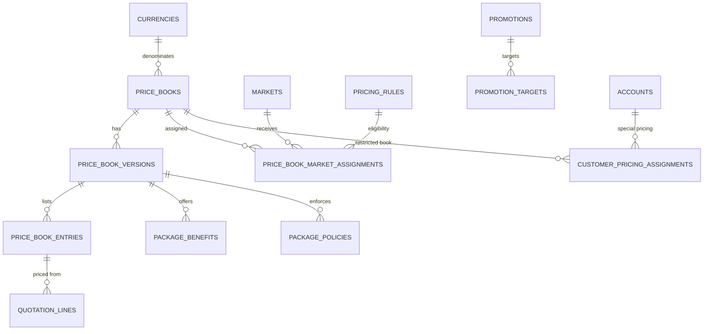
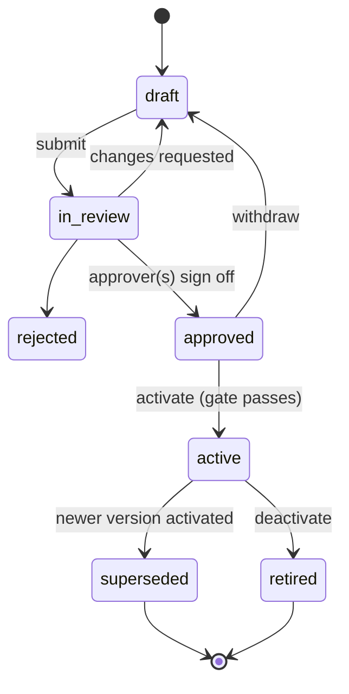

# 04: Pricing Engine Design

Status: **APPROVED 2026-11-10** (BD-032) · **Pricing database: INCOMPLETE (CONFIRMED, BD-017)** · **No pricing or promotion is active.** · Updated 2026-11-09 (v0.2) · **Implemented in Phase 2a (2026-11-10):** §2 to §7, §10 (attachment and approval), §14 (catalogue, lifecycle, history, tier selection), §16 and §18 (golden, property, gate, tier, correction and market-inference tests); **Phase 2b (2026-11-10):** §8 rules and tester, §9 promotions, §11 minimum purchase, special pricing in §7 and imports in §15. Quotations and discount authority (§12, §13) follow in 2c. Implementation notes IN-27 to IN-37.

## 1. Confirmed pricing rules

All rules below are CONFIRMED by Mixt. Decision references: [12-decision-log](12-decision-log.md).

| # | Rule | Decision |
|---|------|----------|
| P-01 | Pricing is held in the database and driven by data. New pricing sheets are added **without code changes**. | S1 |
| P-02 | Countries, currencies, durations, tiers, Standard/Premium/promotional packages and benefits are each supported independently. | S1 |
| P-03 | Supplied figures are **package totals**. **Hourly rates and package totals are separate fields.** | BD-010 |
| P-04 | **One class = one hour** for the supplied class-based schedules, unless a package-specific exception is confirmed later. | BD-011 |
| P-05 | Never invent prices or package durations. | BD-019 |
| P-06 | Never assume pricing for a country that has none. | BD-019 |
| P-07 | Never convert currencies to produce an official price. | BD-019 |
| P-08 | Never mix one country's pricing with another's. | BD-019 |
| P-09 | **Never select a customer's special pricing tier automatically.** | BD-019 |
| P-10 | USD schedules exist as currency records; their **market assignment is unconfirmed**; **USD is never associated with the US market**; the US is not a market. | BD-005, BD-006 |
| P-11 | **UK has two separate, valid tiers; UAE has two separate, valid tiers.** | BD-012, BD-013 |
| P-12 | **Ireland has two separate schedules**, kept separate; their relationship is unconfirmed. | BD-014 |
| P-13 | **Hong Kong has separate Standard and Premium plans.** | BD-016 |
| P-14 | Benefits and policies are stored per package, country and plan; never applied across countries without administrator approval. | BD-022 |
| P-15 | Every quotation records the exact price, currency, tier and package version used. | BD-023 |
| P-16 | Confidential pricing is never disclosed to another customer. | BD-024 |
| P-17 | **Unconfirmed pricing tiers, pricing and promotional rules are never activated.** | BD-020 |
| P-18 | **Promotional terms are kept separate from standard pricing.** | BD-021 |
| P-19 | **Supplied figures are never silently changed; original schedules are preserved.** Corrections become new versions. | BD-015, BD-018 |
| P-20 | **The pricing database stays marked incomplete** while sheets are still being collected. | BD-017 |

**Design rules derived from these (PROPOSED, ADR-13):** a customer's pricing market is confirmed by staff. **Currency, phone prefix and curriculum never decide a market.** A USD-paying, +1-phone or American-curriculum family is not a US-market customer; a British-curriculum student in Dubai is priced as UAE, not UK; an Irish-curriculum student is priced by their confirmed market, not by "Ireland".

## 2. Concepts

| Concept | Meaning | Example |
|---------|---------|---------|
| **Market** | A country Mixt sells into, with its own pricing. US is excluded at database level. | United Kingdom |
| **Currency** | ISO 4217 code with minor units. | GBP (2 decimals) |
| **Price book** | One pricing sheet: one currency, one plan type, optional tier label, one unit type. | `UK-GBP-TIER-A` |
| **Price book version** | An immutable snapshot of a price book's entries, benefits and policies, with an approval and effective dates. | `UK-GBP-TIER-A v1` |
| **Entry (package)** | One purchasable quantity with its **package total**. | 15 hours → £285.00 |
| **Plan type** | `standard`, `premium`, `promotional`, `custom`. | HK Premium |
| **Tier label** | The business name of a tier/schedule. Carries **no automatic meaning**. | "Tier A", "Schedule B" |
| **Audience** | `public` (can be offered to anyone eligible in the market) or `restricted` (only via a customer assignment). | — |
| **Market assignment** | Link of a price book to a market, with status `unconfirmed` / `confirmed` and optional eligibility rule. | USD Schedule A → *(none yet)* |
| **Market default** | The one price book per (market, plan type) offered when no special assignment exists. **Set by an admin**, never inferred. | — |
| **Benefit** | Customer-facing advantage, descriptive. | "Recorded sessions" |
| **Policy** | Enforceable rule with typed values the system acts on. | `validity_months = 18` |
| **Promotion** | Time-limited change to price, units or a promotional price book, with eligibility and expiry. | — |
| **Customer pricing assignment** | Human-approved link of an account to a restricted/special price book. Confidential by default. | — |
| **Tier selection mode** | Per-market setting for choosing between several valid books of the same plan type: `manual` (a person selects per customer, **current default**), `market_default`, or `rule_based`. | UK, UAE, Ireland: `manual` |
| **Tier selection** | A person's recorded choice of tier/schedule for one account (and optionally one opportunity), with reason. Never created by AI. | "UK Tier B selected by J. Smith: reason …" |
| **Version change type** | Why a version exists: `initial`, `correction` (fixes figures; supersedes the version it corrects), or `price_change` (a new commercial price). | Malaysia v2 would be a `correction` |
| **Pricing rule** | Eligibility / minimum-purchase / availability logic stored as validated data. | "Minimum 60 h for Premium" (example only, **not** a confirmed rule) |

## 3. Data model

See [02 §8](02-database-schema.md#8-pricing-full-design-in-04-pricing-engine) for full columns. Summary:



### 3.1 Hourly rate vs package total (P-03)

Each entry stores three separate figures:

| Field | Source | Authority |
|-------|--------|-----------|
| `package_total_minor` | From the pricing sheet | **Authoritative.** The only figure used to charge |
| `advertised_unit_rate_minor` | Only if Mixt's sheet or marketing states an hourly/class rate | Authoritative for display, **if** present |
| `derived_unit_rate_minor` | Computed: total ÷ quantity | **Information only.** Labelled "effective rate". Never used to build a total |

The system **never** computes a total as rate × hours unless an approved policy explicitly says that is how a custom package is priced (none exists today).

In the supplied data every package total divides evenly into a whole-number rate per hour (see [05](05-pricing-data-register.md)). That suggests the sheets were built from per-hour rates, but this is **not assumed**: `advertised_unit_rate_minor` stays empty until Mixt confirms that those rates are official (Q-PRC-08).

## 4. Money handling

- Integers in minor units + ISO currency; Python `Decimal` only for display and percentage calculations. List prices never need rounding. The rounding rule for percentage discounts (e.g. round to the nearest whole currency unit) is set explicitly per currency (Q-PRC-12), never left to a default.
- Display always includes the currency explicitly: `GBP 285.00 / £285`, `AED 1,050`, `RM 1,170`, `HKD 3,200`, `€315`, **`USD 260`** (never a bare `$`, because HKD/SGD etc. also use `$`).
- Amounts in different currencies are **never added together**. Reports group by currency; any combined view must use a labelled, non-official reporting rate.

## 5. Lifecycle and the activation gate

### 5.1 Price book version states



- **Editing an active price = creating a new version.** The old version stays for history and for existing quotations.
- Versions can be **scheduled** (`effective_from` in the future) and are activated automatically at that time **only if** the gate still passes at that moment.

### 5.2 Activation gate (all must pass)

| # | Check |
|---|-------|
| G-01 | Figures confirmed by Mixt (`figures_confirmation = confirmed`), and the data-review checklist for this book is signed off (see [05 §3](05-pricing-data-register.md#3-points-to-double-check-before-activation)). |
| G-02 | At least one **confirmed** market assignment; the market is not excluded. |
| G-03 | If the market has several public books of the same plan type, the market's `tier_selection_mode` is set. `manual` passes this check (a person selects per customer); `market_default` needs a default; `rule_based` needs an approved rule. The engine never guesses. For Ireland, the relationship between the schedules must also be confirmed (Q-PRC-03) before either is activated. |
| G-04 | Unit definition confirmed (hour vs class; minutes per unit). |
| G-05 | Tax treatment set (`inclusive` / `exclusive` / `not_applicable`), not `unknown`. |
| G-06 | Every benefit and policy **attached** to this version is reviewed and approved; any cross-market copy explicitly approved. A version may go live with none attached; then nothing about benefits can be claimed for it (`benefits.claims_mode = approved_only`). |
| G-07 | Approved by a user with `pricing.version.approve`; second approver if the dual-control setting is on (proposed default: on). |
| G-08 | No overlap with another active version of the same book. |
| G-09 | Golden tests generated from the version pass in the pricing test suite (automated pre-activation check). |

**Today, no supplied price book passes the gate**, so none is active. Remaining blockers per book are listed in [05 §1](05-pricing-data-register.md#1-summary-of-supplied-price-books) and [11 §3](11-open-questions.md#3-questions-that-block-pricing-activation-p2-activate). In short:
- **All books:** tax treatment (Q-PAY-04), whether price varies by level/subject (Q-PRC-09), named approvers (Q-PRC-20).
- **Specific books:** figure checks (Q-PRC-14 to Q-PRC-16), Malaysia correction confirmation (Q-PRC-21), Ireland relationship (Q-PRC-03), USD market assignment (Q-MKT-01).
- **No longer blocking:** UK/UAE tier validity (confirmed, BD-012/013, with `manual` tier selection); Ireland class length (confirmed, BD-011); HK plan structure (confirmed, BD-016).

### 5.3 Corrections and preserving originals (BD-015, BD-018, ADR-14)

- A figure is **never edited in place**, not even in a draft that has been reviewed. A correction creates a **new version** with `change_type = correction` and `supersedes_version_id` pointing at the version it corrects.
- The original version stays in the database, visible in **Pricing → History** with its figures, source and dates. Only its status changes (`superseded`, or `rejected` if it never went live).
- The import diff (§15) shows old and new figures side by side; the change summary must state the reason (e.g. "mathematical correction supplied by Mixt on …").
- Quotations already issued from an earlier version keep their snapshot; acceptance after a supersession follows `quotations.on_price_change` (default: a person reconfirms).
- **Malaysia:** Mixt confirmed the totals were mathematically corrected (BD-015). The register holds version 1, received 2026-11-09. If the corrected set differs, it is loaded as version 2 (`correction`); otherwise version 1 is simply confirmed (Q-PRC-21).

## 6. Price resolution algorithm

Input: `account_id`, `student_ids`, requested `plan_type` (optional), requested `quantity` (optional), `at` (timestamp).

```
resolve_options(account, students, plan_type?, quantity?, at):
  1. market := account.market_id
       if NULL or not confirmed          → error MARKET_NOT_CONFIRMED (escalate; never infer from currency, phone prefix or curriculum)
       if market.country is excluded     → error MARKET_EXCLUDED
       if market.status != 'active'      → error MARKET_NOT_ACTIVE
  2. special := active customer_pricing_assignments for account at `at` (approved by a person)
  3. public  := price books with a CONFIRMED assignment to market, audience='public',
                having an ACTIVE version at `at`, passing their eligibility rule for this account
  4. candidates := special ∪ public   (special books appear ONLY through step 2)
       if candidates is empty            → error NO_APPROVED_PRICING_FOR_MARKET
       if plan_type given: filter; if empty → error PLAN_NOT_OFFERED_IN_MARKET
  5. tier decision (only when several public books of the same plan type remain):
       mode := market.tier_selection_mode            -- UK, UAE, Ireland: 'manual' today
       if mode = 'manual':
            selection := active pricing_tier_selections for (account[, opportunity]) made by a person
            if none                       → error TIER_DECISION_REQUIRED (task created for the owner)
            keep only the selected book
       if mode = 'market_default':  keep the market default book
       if mode = 'rule_based':      keep books whose approved eligibility rule passes; if not exactly one
                                     → error TIER_DECISION_REQUIRED
       never choose between them by price, tier label, or customer attributes; the AI never creates a selection
  6. entries := entries of the chosen version(s)
       if quantity given and no entry has exactly that quantity
                                         → error QUANTITY_NOT_OFFERED (+ nearest listed options, no interpolation)
  7. apply minimum-purchase rules (pricing_rules); drop entries that fail, with reasons
  8. promotions := approved, active, in-date, eligible, targeting these entries; non-stackable unless flagged
       promotions are returned as SEPARATE offers next to list price, never silently applied
  9. return options[] each with:
       price_book_code, version_id, version_no, entry_id, package_code, quantity, unit_type,
       minutes_per_unit, package_total_minor, currency, advertised_unit_rate_minor?, derived rate (labelled),
       plan_type, tier_label, benefits[], policies[], promotions[], provenance hash
```

Properties guaranteed by tests:
- **Same inputs + same database state → same output** (deterministic).
- Output currency is always the price book's currency; no conversion code exists in the engine.
- Outputs never contain entries from a market other than the account's confirmed market.
- Special/restricted books appear only for accounts with an approved assignment.

### Error codes (shared by API, agents and UI)

| Code | Meaning | What happens |
|------|---------|--------------|
| `MARKET_NOT_CONFIRMED` | Customer's pricing market not confirmed | Agent asks/escalates; rep confirms |
| `MARKET_EXCLUDED` | Country excluded (e.g. US) | Out-of-market handling |
| `MARKET_NOT_ACTIVE` | Market exists but isn't live | Escalate |
| `NO_APPROVED_PRICING_FOR_MARKET` | No active, confirmed pricing (e.g. Kuwait today) | Escalate; **AI says the team will confirm pricing**, no figures |
| `PLAN_NOT_OFFERED_IN_MARKET` | e.g. Premium requested where none exists | Offer what exists or escalate |
| `TIER_DECISION_REQUIRED` | More than one valid tier/schedule and no tier selected for this customer yet | Task for the account owner to select the tier (with reason); AI waits |
| `QUANTITY_NOT_OFFERED` | Requested hours not in the sheet | Show listed options or request a custom quote (approval) |
| `BELOW_MINIMUM_PURCHASE` | Fails a minimum rule | Show eligible options |

## 7. Tiers and special pricing (P-09)

- Tier labels ("Tier A", "Schedule B") are **just names**. The engine never treats A as cheaper or B as premium.
- **Current status (2026-11-09):** UK Tier A/B and UAE Tier A/B are **valid, separate tiers** (CONFIRMED). Ireland Schedule A/B are **separate schedules** whose relationship is OPEN. *How* a customer is placed on each is OPEN (Q-PRC-02, Q-PRC-03).
- Until Mixt defines that, each of these markets uses `tier_selection_mode = manual` (ADR-12):
  - a person with `pricing.tier.select` picks the tier/schedule for the account (optionally per opportunity) and gives a reason;
  - the choice is stored in `pricing_tier_selections`, audited, and visible on the customer page and the quotation;
  - the AI shows the rep both valid options internally, but **never** picks one and never mentions the other tier to the customer.
- When Mixt confirms a rule, the mode switches to `market_default` or `rule_based` by changing a setting; no code change.
- Separately, **special/confidential pricing** for an individual customer is a **customer pricing assignment** made by a person with `pricing.assign_special`, with reason and approval.
- The Pricing and Negotiation agents can **recommend** that a person consider a tier selection or special assignment. They cannot create either.
- Customer pricing assignments are **confidential by default**: they are visible only to roles with `pricing.special.view` and to agent runs scoped to that same account.

## 8. Eligibility and rules (no code changes needed)

Rules are stored as JSON in a small, validated rule language: conditions over a fixed set of facts, combined with `all` / `any` / `not`.

```json
{
  "all": [
    {"fact": "account.market", "op": "eq", "value": "IE"},
    {"fact": "account.is_new_customer", "op": "eq", "value": true},
    {"fact": "lead.source", "op": "in", "value": ["meta_lead_ads", "website_form"]}
  ]
}
```

- Available facts (initial): market, new/existing customer, lead source, campaign, number of students, curriculum, qualification, account tags, date, existing package history.
- Operators: `eq`, `neq`, `in`, `not_in`, `gte`, `lte`, `between`, `exists`.
- Rules are versioned, need approval, and come with a "test this rule against account X" tool in the admin UI.
- **Example above is illustrative only.** No eligibility rule is confirmed today (Q-PRC-02, Q-PRC-04).

## 9. Promotions

- **Kept separate from standard pricing (BD-021, ADR-15):**
  - a promotion **never edits** a standard price-book entry, version or benefit;
  - it exists only as a separate `promotions` record or a separately labelled **promotional price book** (`plan_type = promotional`), which can never be a market default;
  - quotations show the **standard list price** and the **promotion** as separate items, so it is always clear what is standard and what is promotional;
  - promotional benefits/terms are stored on the promotion, not on the standard version;
  - `promotions.enabled = false` globally until the first promotion is confirmed.
- Kinds: `percent_off`, `amount_off` (same currency as the book), `bonus_units`, or a separate `promotional_price_book`.
- **Mandatory end date.** A scheduled job expires promotions at `ends_at`; expiry is also checked at resolution time.
- Not stackable unless explicitly marked; at most one promotion per line by default.
- Redemption limits overall and per account.
- Lifecycle `draft → in_review → approved → active → expired/cancelled`; activation requires approval and confirmed eligibility.
- **No promotional rule is confirmed today.** The brief mentions promotional packages, but none of the supplied schedules is labelled as promotional (Q-PRC-05).

## 10. Benefits and policies

- Stored **per price book version** (optionally per entry). A benefit is shown to customers only if it is attached to the exact version (and entry) being quoted.
- **Cross-market reuse:** copying a benefit/policy from one market's version to another's creates a new row with `copied_from_id` and requires `cross_market_copy_approved_by` (P-14).
- Enforceable policies drive behaviour:
  - `validity_months` → `package_purchases.expires_at` at activation (+ pause days if `pause_resume`).
  - `no_expiry` → no expiry date.
  - `max_subjects` / `unlimited_subjects` → checked when adding subjects to an active package.
  - `family_sharing` → allows `package_allowed_students` with several students.
  - `refund_or_swap_guarantee` → shown with exact terms; refund requests are always handled by a person.
- The "general benefits supplied so far" are stored as **benefit definitions with no assignments** until Mixt confirms which packages they belong to (Q-PKG-01).

## 11. Minimum package requirements

Stored as `pricing_rules` of kind `minimum_purchase` (e.g. minimum quantity per plan/market/new customer). **None is confirmed.** The fact that HK Premium starts at 60 hours is recorded as data (its smallest entry), **not** turned into a rule (Q-PRC-10).

## 12. Custom quotations and discount authority

- A **custom quotation** (non-listed quantity, discount, special terms) always goes through approval.
- `discount_authority_rules` set, per role (and optionally per market), the maximum discount % / amount a person can approve, and when a second approver is required. Values are to be set by Mixt (Q-PRC-11).
- The approval request shows: list option, proposed price, discount %, effective hourly rate (labelled as derived), customer history, reason, and who prepared it (person or agent).
- AI agents can **prepare** custom-quote requests; they can never approve them.

## 13. Quotations

1. **Draft:** built only from `resolve_options` output (+ approved custom lines). Each line stores a full snapshot: price book code, version id **and** number, entry id, package code, plan type, tier label, quantity, unit type, minutes per unit, list total, discount, promotion, final total, currency, benefits snapshot, policies snapshot.
2. **Validation before approval/issue:**

| # | Check |
|---|-------|
| V-01 | Every line's version is still `active` (or the quote is re-priced as a new revision). |
| V-02 | Line amounts equal the entry's `package_total_minor` minus approved discount. |
| V-03 | All lines share one currency, equal to the price books' currency. |
| V-04 | The account's confirmed market matches the price books' confirmed assignment, or a special assignment exists for this account. |
| V-05 | Promotions valid at issue time; redemption limits respected. |
| V-06 | Discounts within the approver's authority. |
| V-07 | `snapshot_hash` recomputed and matches. |
| V-08 | Recipient is a contact of the same account (no cross-account sending). |
| V-09 | Validity date set (default validity period to confirm: Q-PRC-13). |

3. **Issue:** PDF generated from the snapshot (never re-reading live prices), sent through the customer's channel, `QuotationIssued` event.
4. **Revisions:** any change → new revision; old one `superseded`. Issued quotations are never edited.
5. **Price changes after issue:** an issued quote stays valid at its snapshot price until `valid_until`, unless Mixt decides otherwise (Q-PRC-13).

## 14. Admin pricing module (maps to the brief)

| Brief requirement | Feature |
|-------------------|---------|
| Create pricing tiers | Create price book (currency, plan type, tier label, unit type, audience) |
| Edit package rates | Edit entries in a **draft** version; diff view against the active version |
| Add countries | Add market (excluded countries blocked) |
| Add currencies | Add currency (ISO code, minor units, display prefix) |
| Create Standard and Premium plans | Plan type per price book |
| Add promotional offers / expiry dates | Promotions with mandatory end date |
| Set customer eligibility | Eligibility rules with a rule tester |
| Activate / deactivate pricing | Activation gate checklist; deactivate = retire |
| Mark special customer pricing | Customer pricing assignment with approval; confidential |
| *(added)* Choose between valid tiers/schedules | Per-market tier selection mode; manual tier selection per customer with reason (UK, UAE, Ireland today) |
| *(added)* Record corrections without losing originals | Correction versions with `supersedes_version_id`; originals kept in history |
| *(added)* Keep promotions separate | Promotions and promotional books never modify standard entries |
| Set minimum package requirements | Minimum-purchase rules |
| Approve custom quotations | Approval inbox with authority limits |
| View pricing history | Version timeline, diffs, who/when/why, quotations per version |
| Add pricing sheets without code | Spreadsheet import pipeline (§15) |

## 15. Importing new pricing sheets

1. Upload CSV/XLSX using a provided template (columns: `price_book_code, currency, plan_type, tier_label, unit_type, quantity, package_total, advertised_unit_rate (optional)`).
2. Parse into `pricing_import_rows`; validate: currency exists; quantities positive and unique; totals positive integers in minor units; no duplicate packages; unit type known; **no market assignment is created by import**.
3. Show a **diff** against the current active version and highlight anomalies: identical figures to another book, a non-whole effective rate, a rate that goes up as quantity rises, and large jumps between neighbouring packages.
4. Admin creates a **draft version** from the batch → normal review/approval/activation.

## 16. History and audit

- Versions are immutable; every state change, assignment, rule, promotion and approval is in `audit_log`.
- "Pricing history" view: per price book, all versions with effective periods, approvers, change summaries, and the quotations issued from each.

## 17. The pricing tool (used by AI agents)

```jsonc
// pricing.get_eligible_options: scope (account) comes from the run, never from the model
// request (model-supplied)
{ "student_ids": ["…"], "plan_type": null, "quantity": 30 }

// response: success
{
  "status": "ok",
  "market": "AE",
  "options": [{
    "option_ref": "opt_7f3…",               // must be quoted back when drafting a quotation
    "price_book_code": "…", "version_no": 1, "plan_type": "standard", "tier_label": "…",
    "quantity": 30, "unit_type": "hour", "minutes_per_unit": 60,
    "package_total": {"amount_minor": 0, "currency": "AED", "display": "AED …"},
    "effective_hourly_rate": {"display": "AED …/hour", "label": "derived"},
    "benefits": ["…"], "policies": ["…"], "promotions": []
  }]
}

// response: refusal
{ "status": "unavailable", "code": "NO_APPROVED_PRICING_FOR_MARKET",
  "customer_safe_message": "Our team will confirm the package options for your country shortly.",
  "escalation_required": true }
```

The price guard (see [03 §9](03-ai-agent-architecture.md#9-guardrails)) accepts only amounts that appear in an `options[].package_total.display` returned in the same run, or in a quotation already issued to this account.

## 18. Tests (Phase 2 exit criteria)

- **Golden tests:** one test per supplied entry asserting total, currency, quantity and unit exactly as in [05](05-pricing-data-register.md).
- **Property-based tests** (Hypothesis): resolution never returns another market's entries; never returns a restricted book without an assignment; never returns an inactive/expired version or promotion; output currency always equals book currency.
- **State machine tests:** activation gate rejects each missing condition individually.
- **Leakage tests:** account B's special pricing never appears for account A.
- **Market-inference tests (ADR-13):** an account with a +1 phone number, a USD budget, or the American curriculum but **no confirmed market** gets `MARKET_NOT_CONFIRMED`, never USD or "US" pricing; a US market cannot be created; USD books never resolve without a confirmed, non-US market assignment.
- **Tier tests (ADR-12):** in a `manual` market with two valid tiers, resolution returns `TIER_DECISION_REQUIRED` until a person's selection exists, then returns only the selected tier; an agent principal cannot create a selection.
- **Correction tests (ADR-14):** loading a correction creates a new version; the original's entries are unchanged and still readable; issued quotations keep their snapshot.
- **Promotion tests (ADR-15):** activating, expiring or cancelling a promotion leaves every standard entry byte-for-byte unchanged.
- **Concurrency tests:** activating a new version while quotations are being drafted doesn't create mixed-version quotations.
