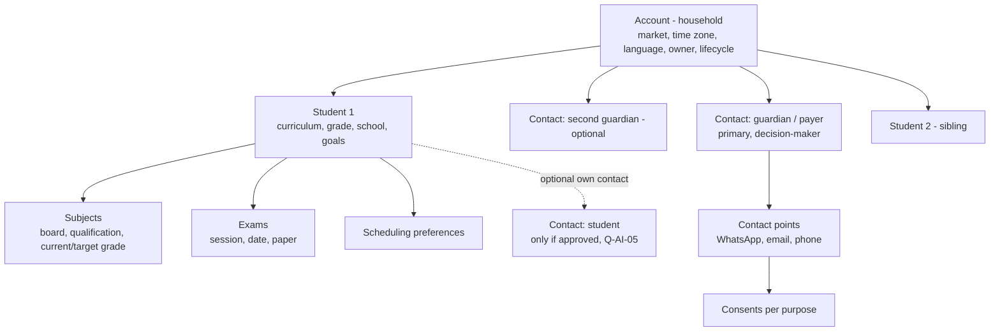
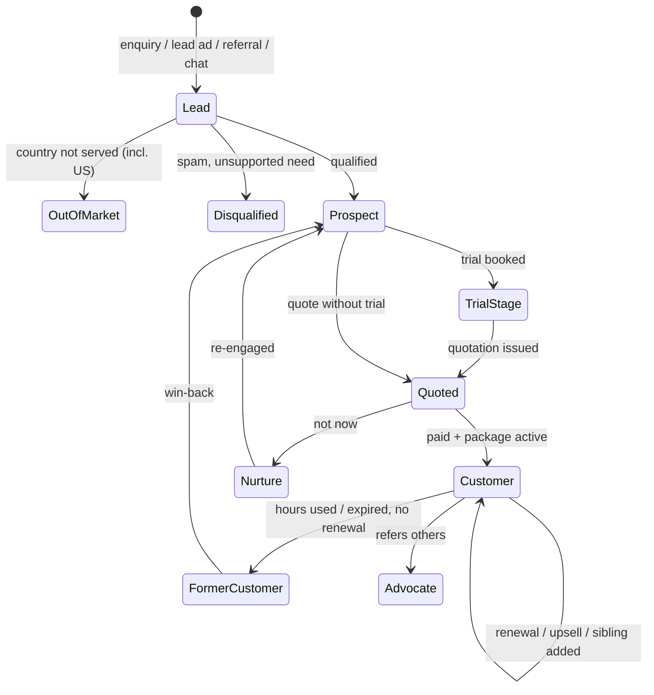

# 06: CRM Structure

Status: **PROPOSAL, awaiting approval** · Table definitions: [02-database-schema](02-database-schema.md)

## 1. Core model: household → people → students

Why this shape:
- **Several students under one parent account** (CONFIRMED requirement) and family hour sharing (a supplied benefit) both need the household as the buying unit.
- Guardians and students are kept separate, so the system knows who is a minor, who pays, who decides, and who may be contacted.
- Contact points are separate records, each with its own consent and status, so a WhatsApp opt-out does not affect email service messages.
- `institution` accounts (schools, partners) are possible later without a redesign (Q-BIZ-03).

## 2. Customer journey

`accounts.lifecycle_stage` tracks the household; each buying cycle is an **opportunity** with its own pipeline.

## 3. Leads

| Aspect | Design |
|--------|--------|
| What a lead is | The raw, unaltered record of an enquiry from one source (`leads`), kept for attribution even after it is matched to an account. |
| Sources | Meta Lead Ads, Instagram (lead ads and/or DMs: Q-COM-04), website form, website chat, inbound WhatsApp, inbound email, referral, partner, manual, import. |
| Attribution | Source, campaign/ad/form IDs, UTM parameters, landing page, referrer, first-touch vs last-touch on the account. |
| Normalisation | Phone → E.164 using the submitted country; email lower-cased; country → ISO code; names trimmed. |
| Duplicate detection | Exact match on phone/email contact points → link to the existing account; fuzzy name + school match → "possible duplicate" for a person to review. Merges are logged and reversible from the snapshot. |
| Market check | Submitted/detected country ∈ the 13 operating markets (BD-004) → continue. US or another non-target country → `out_of_market`: no automated outreach, no pricing, never added as a market (BD-005); handling per Q-MKT-02 (safe default: a person reviews). |
| Pricing market | Confirmed **by staff** on the account (`market_confirmed_by/at`). Currency, phone prefix (e.g. +1) and curriculum are **never** used to set it (ADR-13). |
| Consent capture | Wording shown on the form, timestamp and form ID stored as evidence in `consents`. |
| Speed-to-lead | SLA timer from `received_at` to first human-approved response (target to set: Q-TEAM-03). |

## 4. Sales pipeline (default `new_business` pipeline: PROPOSAL)

Stages are configurable data. Proposed defaults:

| # | Stage | Entry criteria (required fields) | Typical agent help | Exit |
|---|-------|----------------------------------|--------------------|------|
| 1 | **New** | Lead matched to account | Qualification Agent scores | Contacted |
| 2 | **Contacted** | First outbound message sent | Sales Agent drafts first reply | Engaged / Nurture |
| 3 | **Discovery** | Customer replied | Sales Agent asks discovery questions; extracts facts | Qualified |
| 4 | **Qualified** | Confirmed market; curriculum; at least one student with grade and subject(s) | Research brief; Pricing options (if market priced) | Trial / Quote |
| 5 | **Trial scheduled** | Trial with tutor and time | Matching + Scheduling | Trial completed / No-show |
| 6 | **Trial completed** | Trial outcome recorded | Sales Agent follow-up | Quote |
| 7 | **Quotation sent** | Issued quotation | Follow-up Agent check-ins | Negotiation / Won / Lost |
| 8 | **Negotiation** | Objection or discount request logged | Negotiation Agent advises; approvals | Quotation sent (revised) / Won / Lost |
| 9 | **Won: payment pending** | Quotation accepted | Payment Tracking | Won: paid |
| 10 | **Won: paid / onboarded** | Payment verified; package active; tutor assigned | Retention starts | (closed won) |
| — | **Lost** | Lost reason required | Manager review | Nurture sequence (if consent) |
| — | **Nurture** | Reason + revisit date | Follow-up Agent | Back to Discovery |

Other pipelines: **Renewal** (opened by the Retention Agent on low balance or upcoming expiry) and **Upsell / sibling addition**.

Whether a free trial is always offered, and in which markets, is unknown (Q-SAL-02). The pipeline lets "Quotation sent" follow "Qualified" directly.

## 5. Student academic profile

| Field | Notes |
|-------|-------|
| Curriculum | Irish / SABIS / American / British (CONFIRMED, BD-007; IB not included, BD-008). The curriculum never determines the pricing market. |
| Grade / year level | Per-curriculum grade list (to be supplied: Q-ACA-03) |
| School | Free text + optional link to a school reference list later |
| Subjects | Each with exam board, qualification, current grade, target grade, priority |
| Exams | Exam session (e.g. "May/June 2027"), exact date if known, paper codes |
| Goals | Free text (e.g. "move from grade 5 to 7", "11+ preparation") |
| Learning needs | **Restricted and encrypted**, only if volunteered by the guardian; visible only to authorised roles |
| Preferred tutor | Link to tutor (e.g. continuity after a trial or for siblings) |
| Scheduling preferences | Time zone, preferred days/windows, lessons per week, session length |

Data minimisation: year of birth, not full date of birth, unless Mixt needs it (Q-CMP-04).

## 6. Contact points and consent

- Each contact point has a status (`active`, `bounced`, `invalid`, `opted_out`) and is verified when the customer has actually replied from it.
- `consents` is an append-only history per contact (and contact point) and **purpose**: service messages, WhatsApp marketing, email marketing, session recording, AI-assisted conversation, data processing.
- The messaging layer checks consent **at send time**, not only when a sequence starts.
- Opt-out keywords on WhatsApp, unsubscribe links in email, and staff-logged verbal requests all write a `withdrawn` consent row and add to the suppression list within seconds.

## 7. Ownership and assignment

- Every account has an owner (sales rep). Assignment rules (data) match on market, language, source, VIP and workload, using round-robin, least-loaded or fixed strategies.
- Record-level access: reps see their own accounts plus an "unassigned pool" (configurable); managers see their teams; admins see everything (see [08](08-security-privacy.md)).
- Ownership changes are logged with reason.

## 8. Customer timeline (activities)

One chronological view per account combining: WhatsApp and email messages, calls and meetings logged, notes, stage changes, quotations (drafted/issued/viewed/accepted), trials, payments, package activations, hours used, escalations, AI suggestions accepted or rejected. It is built from domain events, so every module adds to it automatically.

## 9. Tasks and follow-ups

- Tasks can be assigned to a person **or** an agent (agents are principals).
- Types: follow-up, call, review AI draft, approval, data fix, payment chase, renewal, other.
- Follow-up **sequences** are approved data: steps with delays, channel, template or "AI-personalised draft", and stop conditions (reply, opt-out, purchase, escalation, human takeover).
- Global guards: frequency caps per contact per channel per week, quiet hours in the contact's time zone, working days per market.

## 10. Trials

Status flow: `requested → proposed → scheduled → completed | no_show_student | no_show_tutor | cancelled | rescheduled`.
Captured: tutor, subject, scheduled time (stored UTC, displayed in each party's time zone), meeting link, whether free, outcome, tutor feedback and customer feedback. The outcome drives the next pipeline stage and the Follow-up sequence.

## 11. Packages, hours and payments (customer view)

- **Package history:** every purchase with its price book version, quantity, amount, currency, activation and expiry dates, and policies at purchase time.
- **Hours balance:** live balance from the append-only ledger; per-student usage when hours are shared within a family (only where the package's policy allows sharing).
- **Payment status:** invoices and payments with status; overdue flags; nothing marked paid without provider verification or finance confirmation.
- Lesson consumption data source is unknown (Q-TUT-02). The ledger can be fed from Mixt AI's own lesson records **or** imported from Mixt's existing system.

## 12. Retention signals and health score (configurable)

| Signal | Example rule (to tune with Mixt) |
|--------|----------------------------------|
| Low balance | ≤ 20% of purchased units remaining |
| Expiry approaching | Within 60 days of `expires_at` (e.g. Ireland 18-month validity) |
| Usage drop | Lessons per week down > 50% vs previous 4 weeks |
| Cancellations / no-shows | ≥ 2 in 30 days |
| Feedback | Lesson rating ≤ 3/5 or negative sentiment in messages |
| Payment | Overdue invoice |
| Milestone | Exam completed → re-engagement opportunity |

The health score (0–100, bands *healthy / watch / at risk*) is a weighted, explainable combination; the factors are stored with each score so reps can see *why* a family is at risk.

## 13. Referrals

- Referral programmes (rewards, eligibility, dates) are approved data. **No referral reward is defined today** (Q-SAL-05).
- Each referrer gets a unique code/link; referred leads are attributed automatically (code, link or manual).
- Statuses: `submitted → qualified → converted → rewarded`. Rewards (e.g. bonus hours or credit) need approval and are written to the hours ledger or account credit with a full audit trail.
- The Retention Agent suggests referral requests only to healthy, satisfied customers who have marketing consent.

## 14. Data quality rules

- Stage entry requirements (§4) are enforced by the pipeline service. An agent cannot move an opportunity forward while required fields are missing.
- AI-extracted values are **proposed** facts with source message and confidence; critical fields need human confirmation.
- Validation: phone numbers via libphonenumber; emails syntax + bounce feedback; exam dates in the future when entered; curriculum/board/qualification combinations from the reference data.
- A weekly data-quality report (Sales Manager Agent) lists missing owners, stale opportunities, unconfirmed markets and duplicates.

## 15. Customer 360 screen (summary)

Header (household name, market, time zone with local time now, language, owner, lifecycle, VIP, health band) · Contacts and consents · Students with academic profiles · Open opportunities and stage · Quotations · Packages and hours balance · Payments · Trials and lessons · Timeline · Tasks · AI panel (latest summary, suggested next action, pending drafts awaiting approval, open escalations).

## 16. Core metrics (definitions to agree with Mixt)

| Metric | Definition |
|--------|-----------|
| Speed to lead | Median time from lead received to first outbound message sent |
| Lead → qualified rate | Qualified opportunities ÷ leads matched (by source, market, month) |
| Trial booking rate | Opportunities reaching *Trial scheduled* ÷ qualified |
| Trial → won rate | Won ÷ trials completed |
| Quote → won rate | Won ÷ quotations issued |
| Average package size | Mean purchased units, by market and plan |
| Revenue | Sum of verified payments **per currency** (never summed across currencies) |
| Renewal rate | Renewed ÷ packages exhausted or expired in the period |
| AI draft acceptance | Drafts approved without major edits ÷ drafts reviewed |
| Escalation rate | Escalations ÷ AI-handled conversations, by reason |
