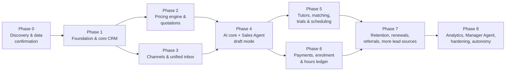

# 10: Implementation Roadmap

Status: **APPROVED 2026-11-10** (BD-032) · **Phase 0 complete; Phase 1 in progress (1a done 2026-11-10).**

## Approach

- **Data correctness before automation.** CRM and pricing are built and tested before any AI talks to customers.
- **People in the loop before autonomy.** Channels launch with human-only messaging, then AI drafts with approval, then gradual autonomy.
- **Each phase ships usable software** to the Mixt team and ends with explicit exit criteria.
- **Definition of done** (every phase): working code, automated tests passing in CI, migrations, documentation updated, security review of new surfaces, and a demo to Mixt. Nothing is reported as implemented without this.
- **Effort sizing** is relative (S/M/L/XL). Calendar estimates depend on team size and the answers in [11](11-open-questions.md) (Q-TEAM-05), so none are given yet.

## Phase overview

Phases 2 and 3 can run in parallel after Phase 1. Phases 5 and 6 can run in parallel after Phase 4.

---

## Phase 0: Discovery and business-data confirmation: **complete (2026-11-10)**

| Deliverables | Status |
|--------------|--------|
| Requirements analysis, architecture, schema, agent design, pricing design, CRM design, integrations, security, UX direction, roadmap, open questions | **Drafted in this repository: awaiting approval** |
| Pricing data register (supplied figures, verified by script against the brief) | Drafted; **incomplete and not active** |
| First round of business confirmations applied (markets, US exclusion, USD rule, curricula, 1:1 model, class = 1 hour, UK/UAE tiers, Ireland schedules, Malaysia correction, HK plans, catalogue incomplete) | **Done (v0.2, 2026-11-09)**: see [decision log](12-decision-log.md) |
| Configurable settings register with safe defaults for open decisions | **Drafted**: [13](13-configurable-settings.md) |
| Answers to remaining questions | Waiting for Mixt; only 3 questions block Phase 1 production use ([11 §2](11-open-questions.md#2-questions-that-block-phase-1)) |
| External accounts started (Meta verification, WhatsApp numbers, email platform access, payment provider, cloud account, LLM provider terms) | Waiting for Mixt |
| Legal review kick-off (hosting region, consent wording, children's data, AI disclosure) | Waiting for Mixt |

**Exit criteria:** architecture **explicitly approved** by Mixt (BD-031): **met on 2026-11-10 (BD-032)**. Open business questions do **not** hold up the start of Phase 1: each has a safe default setting. Before Phase 1 is used with real customer data: hosting region (Q-CMP-02), legal/privacy sign-off (Q-CMP-01) and production cloud account (Q-TECH-04).

## Phase 1: Foundation and core CRM (L): **in progress**

Delivered in four increments, each tested and pushed:

| Increment | Scope | Status |
|-----------|-------|--------|
| **1a** Backend foundation | Project set-up, CI, core utilities, migrations, sign-in with MFA, sessions, CSRF, roles with market scope, record-level access, hash-chained audit log, reference data (US blocked), settings register with Outstanding decisions, CRM households/contacts/contact points/consents/students/subjects/exams | **Done 2026-11-10**: 90 automated tests, 91.6% coverage; details in [services/backend/README.md](../services/backend/README.md) |
| **1b** Leads and pipeline | Lead intake (manual + CSV import with consent evidence), duplicate review and merge, pipelines and stages with required fields, opportunities, tasks and follow-ups, notes and tags, customer timeline, outbox and scheduled-action dispatcher, scheduling preferences API | Next |
| **1c** Dashboard | Next.js shell, design system, sign-in and MFA screens, Leads, Customers (360 v1), Pipeline, Tasks, Team, Settings incl. Outstanding decisions | Planned |
| **1d** Hardening | Rate limiting (Redis), SSO option, staging deployment, separate migration and application database roles, backups and restore check | Planned |

Original Phase 1 scope:

- Monorepo scaffolding; Docker compose; CI (lint, types, tests, migrations, import boundaries, secret/dependency scanning).
- Core platform: config, structured logging, tracing, error tracking, money and time-zone utilities, outbox + event dispatcher, scheduled actions, dead-letter handling.
- Identity: users, MFA, sessions, roles/permissions, record-level policy module, agent principals.
- Audit log with hash chain.
- Reference data: markets (US excluded at DB level), currencies, curricula, boards, qualifications, subjects.
- CRM: accounts, contacts, contact points, consents, students, subjects, exams, preferences, notes, tags, merge.
- Leads (manual + CSV import with consent evidence), pipeline and stages, opportunities, tasks, timeline.
- Dashboard shell with design system; Leads, Customers (360 v1), Pipeline, Tasks, Team, Settings screens.

**Exit criteria:** Mixt staff can log in with MFA, manage leads/households/students/opportunities/tasks with correct permissions; audit trail verified; ≥ 85% coverage on domain modules; staging deployed.

## Phase 2: Pricing engine and quotations (L)

- Price books, versions, entries, market assignments, benefits, policies, rules, promotions, customer pricing assignments, discount authority.
- Activation gate; dual approval; history and diffs; spreadsheet import with anomaly detection.
- Deterministic resolution engine with error codes; pricing API.
- Quotations: builder from resolved options, approvals, immutable snapshots, PDF, revisions.
- Load the 13 supplied price books as **drafts**, figures unchanged; tier selection mode `manual` for UK, UAE and Ireland; Malaysia as version 1 (a corrected set, if supplied, as version 2).
- Per-market tier selection, correction versions, separate promotions, settings register and "Outstanding decisions" view.

**Exit criteria:** golden tests for all 91 supplied entries; property tests (no cross-market results, no restricted books without assignment, no conversion); activation gate tests; a test quotation round trip in staging; **Mixt's pricing owner signs off each book before it is activated**.

## Phase 3: Communication channels and unified inbox (L)

- Integration framework: connections, encrypted credentials, ingress service, webhook verification, raw event store, retries, DLQ UI.
- WhatsApp Cloud API: inbound/outbound, templates, 24-hour window, media, statuses, opt-in/opt-out, quiet hours, frequency caps.
- Email adapter (Gmail **or** Microsoft 365, whichever Mixt uses): inbound sync, send, threading, bounces, unsubscribe.
- Website enquiry form endpoint (bot protection, consent capture).
- Unified inbox (human-only messaging at this stage), assignment, takeover, SSE live updates.

**Exit criteria:** end-to-end tests with WhatsApp **test numbers** and test mailboxes; webhook signature tests (valid/invalid/replayed); no lost messages under simulated outages (replay from DLQ); Mixt team using the inbox in staging.

## Phase 4: AI core and Sales Agent in draft mode (XL)

- Model Gateway with Claude and OpenAI adapters, profiles, fallback, cost tracking.
- Agent runtime: router, context builder (single-account scope), tool registry, Action Policy Engine, approval inbox, guardrails (price, claims, confidentiality, market, channel, safety, promise), escalations, kill switches, circuit breakers, run logs.
- Knowledge base with approval and pgvector retrieval; first content from Mixt (curricula, FAQs, objection library, policies).
- Agents: **AI Sales Agent** (draft mode), **Lead Qualification**, **Follow-up**, **Pricing** (tool wrapper), **WhatsApp Communication** and **Email Outreach** (channel logic).
- Evaluation harness, scenario suites, red-team set, CI gate.
- Shadow mode (L0) → draft & approve (L1) rollout.

**Exit criteria:** eval suite passes all hard checks (no unlisted prices, correct escalation for unpriced markets like Kuwait, no USD-as-US, no leakage, injection resistance); ≥ 2 weeks of L1 use with acceptance metrics reported; zero guardrail escapes.

## Phase 5: Tutors, matching, trials and scheduling (L)

- Tutor profiles, capabilities, languages, compliance checks, availability, capacity.
- Tutor Matching Agent (filters + scoring + rationale) with coordinator approval.
- Scheduling Agent: slot finding across time zones, calendar integration, video links, reminders, reschedules, no-shows, trial outcomes.

**Exit criteria:** property tests for slot finding (no double booking, respects availability and time zones incl. DST changes in UK/Ireland); coordinator approval flow in production.

## Phase 6: Payments, enrolment and hours ledger (L)

- Payment provider integration (chosen in Phase 0), invoices, payment links, webhook verification, manual bank-transfer confirmation.
- Payment Tracking Agent (reminders in draft mode).
- Student registration and package activation; hours ledger; expiry, pause/resume and family sharing driven by package policies; lesson-consumption feed (native or import).

**Exit criteria:** ledger invariants tested; reconciliation tests for partial/over/duplicate payments; currency mismatch blocked; finance sign-off.

## Phase 7: Retention, renewals, referrals and more lead sources (M–L)

- Retention Agent: health scores, low-balance/expiry alerts, renewal opportunities, check-ins, win-back.
- Referral programmes, codes, attribution, reward approval.
- Facebook/Instagram Lead Ads; Instagram DMs (if in scope); website chat widget; Lead Generation and Lead Research agents; Negotiation Agent.

**Exit criteria:** renewal opportunities created correctly in tests and pilot; Lead Ads reconciliation proven (no missed leads); chat widget passes security review.

## Phase 8: Analytics, Sales Manager Agent, hardening and autonomy (M–L)

- Reports module and metric definitions; Sales Manager Agent (digests, SLA monitoring, QA sampling, anomaly alerts).
- Performance and load tests; external penetration test; DR restore drill; privacy workflows (DSAR, retention jobs) complete.
- Autonomy reviews: promote specific low-risk action types to L2 where metrics justify it, with management sign-off.

**Exit criteria:** pen-test findings fixed; restore drill within RTO; documented autonomy decisions.

---

## Critical path and external lead times

| Item | Needed by | Risk if late |
|------|-----------|--------------|
| Meta business verification + WhatsApp number + templates | Phase 3 | WhatsApp channel blocked |
| Email platform admin access (Google/Microsoft) | Phase 3 | Email channel blocked |
| Pricing confirmations (tiers, eligibility, tax, USD market assignment, Ireland schedules) | Phase 2 exit | Pricing stays inactive → AI cannot quote |
| Hosting region / legal advice | Before any real customer data (Phase 1 production) | Re-platforming risk |
| Knowledge content (curricula explanations, FAQs, objection library, tone guide) | Phase 4 | AI quality |
| Payment provider merchant account | Phase 6 | Payments tracking only manual |
| Meta App Review for Lead Ads | Phase 7 | Lead Ads intake blocked |

## Suggested team (to confirm: Q-TEAM-05)

Tech lead / architect · 2 backend engineers (Python) · 1 frontend engineer (Next.js) · 1 AI engineer (agents, evals) · part-time DevOps/security · product owner from Mixt (decisions, content, acceptance) · Mixt pricing owner and sales lead as reviewers.
